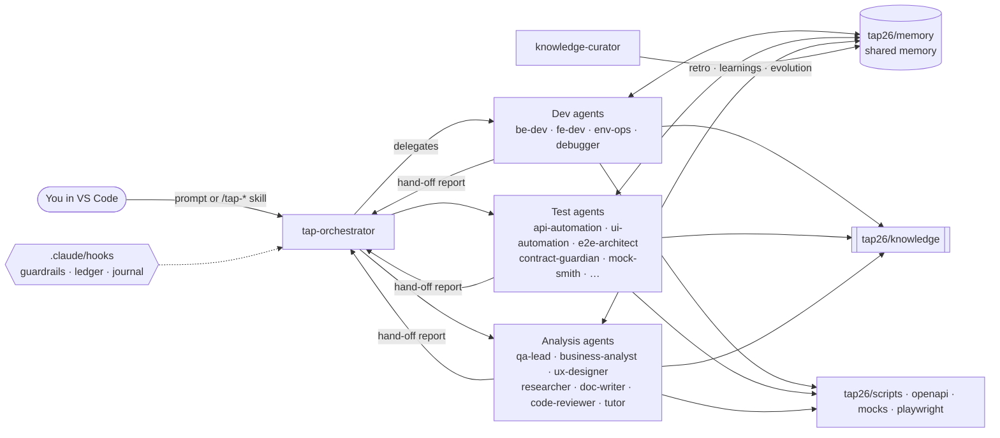

# TAP26-Junior — START HERE

> Version **1.0.0** · A multi-agent Claude Code framework for learning agentic development & testing
> on the Cypress Real World App (RWA).

TAP26-Junior turns Claude Code into a small software team that lives inside this repository. A
**lead orchestrator** listens to what you ask, plans the work, and hands each step to a specialist:
**24 agents** in all (an orchestrator + 23 specialists) — backend and frontend developers, API/UI/E2E automation engineers, a contract
guardian, a debugger, a QA lead, a tutor and more. They share a **memory** (facts, decisions,
learnings, a ledger of app changes), read a curated **knowledge base**, use zero-dependency **Node
scripts** as tools, and are kept safe by **hooks** that block risky commands. You drive all of it from
the Claude Code panel in VS Code with **31 `/tap-*` slash commands** or plain English.

## 5-minute quick start (VS Code)

1. **Open the folder.** In VS Code: *File → Open Folder…* → select the repository root (the folder that
   contains `package.json` and `tap26/`). Trust the workspace when asked.
   If the repo has no `.claude/` folder yet (TAP26 delivered as a bundle), install it once with
   `node tap26/install/install.mjs` — see [install/README.md](install/README.md).
2. **Create the `tap26-base` branch** (once). Labs branch from it and reset back to it. In the VS Code
   terminal (`` Ctrl+` ``; Git Bash on Windows) at the repo root:
   zip download → `git init -b tap26-base && git add -A && git commit -m "TAP26 baseline"`;
   existing git clone → commit or stash local work, then `git switch -c tap26-base`.
   Details: [Lab 01](labs/lab-01-setup.md) step 0.
3. **Install the extension.** Extensions view (`Ctrl+Shift+X` / `Cmd+Shift+X`) → search **Claude Code**
   (publisher: Anthropic) → *Install*. Sign in when prompted.
4. **Open the Claude panel.** Click the **Spark** icon in the editor toolbar (top-right, visible when a
   file is open), or the **✻ Claude Code** item in the status bar, or *Command Palette* (`Ctrl+Shift+P` / `Cmd+Shift+P`) → type "Claude Code" → *Open in New Tab*.
5. **Type `/tap-start`** and press Enter. The orchestrator runs the environment doctor, explains the
   framework in ten lines and tells you which lab to do first.
6. If the doctor reports missing dependencies, type **`/tap-setup`**, then **`/tap-run`** to start the
   app (UI http://localhost:3000, API http://localhost:3001). Log in as `Heath93` / `s3cret`.

Full walkthrough with prerequisites (Node 22, Yarn 1, Git): [docs/01-getting-started-vscode.md](docs/01-getting-started-vscode.md).

## The 10 most useful slash commands

Type `/tap-` in the prompt box to see all 31. Full reference: [docs/04-skills.md](docs/04-skills.md).

| Command | What it does | Example |
|---|---|---|
| `/tap-start` | Onboarding: doctor + tour + next lab | `/tap-start I know Cypress, new to agents` |
| `/tap-run` | Start the app (optionally Swagger + mocks) and check health | `/tap-run all` |
| `/tap-run-tests` | Run Playwright projects and triage failures | `/tap-run-tests ui "bank account"` |
| `/tap-change-api` | API change → OpenAPI → tests → docs → review | `/tap-change-api add optional "nickname" to POST /bankAccounts` |
| `/tap-change-ui` | UI change → selectors → tests → docs → review | `/tap-change-ui show the account count on the bank accounts page` |
| `/tap-sync-tests` | Update tests after you (or an agent) changed the app | `/tap-sync-tests --since tap26-base` |
| `/tap-new-test` | Write a new API/UI/E2E test from a description | `/tap-new-test api "liking a transaction twice is rejected"` |
| `/tap-debug` | Root-cause a failure or weird behaviour | `/tap-debug new-transaction.spec.ts fails on mobile` |
| `/tap-ask` | Ask one role a question | `/tap-ask ba what acceptance criteria fit "request money"?` |
| `/tap-explain` | Have the tutor explain a concept or a file | `/tap-explain how the seed fixture works` |

## How to talk to the agents

You have three ways to get work done — mix them freely:

- **Just describe the task.** *"Add a 'note' field to bank accounts and cover it with tests."* The main
  chat follows the orchestrator protocol in `CLAUDE.md`: it classifies the request and routes it to the
  right specialists.
- **Name an agent.** *"Use the be-dev agent to explain why POST /transactions returns 422."* or
  *"Ask the a11y-auditor to check the sign-in page."* Good when you already know who should answer.
- **Use a skill.** `/tap-change-ui …` runs a fixed, quality-gated pipeline of agents.

Give context with **@-mentions**: type `@` and pick a file (`@backend/bankaccount-routes.ts`), or
select lines in the editor and press `Alt+K` / `Option+K` to insert `@file.ts#5-10`.
Ask for a **plan first** on anything big (*"Plan only, don't edit yet"*). More in
[docs/12-prompting-guide.md](docs/12-prompting-guide.md).

Every agent ends with a **hand-off report** (status, changed files, verification, risks, memory
updated, next agent), so you always know what happened.

## Map of the `tap26/` folder

| Path | What lives there |
|---|---|
| `README.md` | this page |
| `BLUEPRINT.md` | the internal contract: names of every agent, skill, script and gate |
| `docs/` | student documentation (start at [docs/00-index.md](docs/00-index.md)) |
| `labs/` | 15 guided exercises, `lab-01-setup.md` … `lab-15-evolve.md` |
| `memory/` | shared memory: `MEMORY.md` digest, facts, decisions, learnings, change ledger; `journal/` and `.state/` are local-only (gitignored) |
| `knowledge/` | curated app map and conventions; `knowledge/generated/` is produced by `scan-app.mjs` |
| `openapi/` | `openapi.yaml` (source of truth) and generated `openapi.json` |
| `swagger/` | Swagger UI page served on http://localhost:3100 |
| `mocks/` | spec-driven mock server scenarios and fixtures (http://localhost:3101) |
| `templates/` | bug report, test case, user story, ADR, PR, test plan, report templates |
| `evolution/` | self-evolution proposals, `CHANGELOG.md`, `metrics.md` |
| `reports/<type>/` | generated outputs (impact, a11y, security, perf, research, test plans…), mostly gitignored; `retros/` and `bugs/` are committed |
| `scripts/` | Node tools: `doctor`, `memory`, `scan-app`, `impact`, `spec-drift`, `swagger-server`, `mock-server`, `perf-smoke`, `check-framework` |

Outside `tap26/`: agents in `.claude/agents/`, skills in `.claude/skills/`, hooks in `.claude/hooks/`,
path-scoped rules in `.claude/rules/`, and the Playwright framework in [`playwright/`](../playwright/README.md).

## Documentation and labs

| Learn | Do |
|---|---|
| [00 Index & reading order](docs/00-index.md) | [Lab 01 — Setup](labs/lab-01-setup.md) |
| [01 Getting started in VS Code](docs/01-getting-started-vscode.md) | [Lab 02 — Run the app](labs/lab-02-run.md) |
| [02 Architecture](docs/02-architecture.md) | [Lab 03 — Explore](labs/lab-03-explore.md) |
| [03 Agents](docs/03-agents.md) · [04 Skills](docs/04-skills.md) | [Lab 04 — Ask the roles](labs/lab-04-ask-roles.md) |
| [05 Memory & self-learning](docs/05-memory-and-self-learning.md) | [Lab 05 — First API test](labs/lab-05-first-api-test.md) |
| [06 Workflows](docs/06-workflows.md) | [Lab 06 — First UI test](labs/lab-06-first-ui-test.md) |
| [07 Testing framework](docs/07-testing-framework.md) | [Lab 07 — API change](labs/lab-07-api-change.md) |
| [08 API contract & Swagger](docs/08-api-contract-and-swagger.md) | [Lab 08 — UI change](labs/lab-08-ui-change.md) |
| [09 Mocks & stubs](docs/09-mocks-and-stubs.md) | [Lab 09 — Sync tests](labs/lab-09-sync-tests.md) |
| [10 Hooks & guardrails](docs/10-hooks-and-guardrails.md) | [Lab 10 — Swagger](labs/lab-10-swagger.md) |
| [11 Evolving TAP26](docs/11-evolving-tap26.md) | [Lab 11 — Mocks](labs/lab-11-mocks.md) |
| [12 Prompting guide](docs/12-prompting-guide.md) | [Lab 12 — E2E journey](labs/lab-12-e2e-journey.md) |
| [13 Troubleshooting](docs/13-troubleshooting.md) | [Lab 13 — Debugging](labs/lab-13-debugging.md) |
| [14 FAQ](docs/14-faq.md) · [Glossary](docs/glossary.md) | [Lab 14 — Docs](labs/lab-14-docs.md) · [Lab 15 — Evolve](labs/lab-15-evolve.md) |

## Safety notes — read once

- **Seeding wipes data.** Every Playwright test, `/tap-data reset`, `yarn db:seed:dev` and
  `POST /testData/seed` reset `data/database.json` to the seed. Anything you created by hand in the app is lost.
- **Hooks are guardrails, not a guarantee.** `.claude/hooks/guard-bash.mjs` blocks clearly destructive
  shell commands (`sudo`, `rm -rf` on root/home/project paths, `git push --force`, `curl … | sh`) and asks
  before risky ones (`git reset --hard`, `git push`, `git branch -D`, `git stash drop`, `git switch --force`,
  `yarn db:seed`). `guard-edit.mjs` asks before anyone edits the seed, `.env` files, lockfiles, the
  guardrails themselves, `CLAUDE.md` or the agent, skill and rule files in `.claude/`. Neither is a sandbox —
  read each permission prompt before approving it. See [docs/10-hooks-and-guardrails.md](docs/10-hooks-and-guardrails.md).
- **Review diffs before committing.** Agents edit real files. Use VS Code's Source Control view or
  `/tap-review` to read the diff; agents never commit or push unless you ask them to.
- **Stay local.** Security and performance agents only probe `localhost`. Never point them at systems you
  do not own.
- **No secrets in prompts or memory.** Memory files are committed to git and shared with your team. The
  session journal (`tap26/memory/journal/`, your prompts) and `tap26/memory/.state/` stay on your machine
  (gitignored).

## Versioning

TAP26-Junior follows semantic versioning. This is **1.0.0**. Framework changes are proposed with
`/tap-evolve`, approved by a human, applied by `knowledge-curator`, and recorded in
`tap26/evolution/CHANGELOG.md`; `/tap-evolve apply` bumps the version here, in `tap26/package.json` and in
`TAP26_VERSION` (`.claude/settings.json`), then `node tap26/scripts/check-framework.mjs --strict` must pass. Patch = wording/fixes, minor = new agent/skill/hook, major = changed
contracts (hand-off format, memory format, skill names). See [docs/11-evolving-tap26.md](docs/11-evolving-tap26.md).
