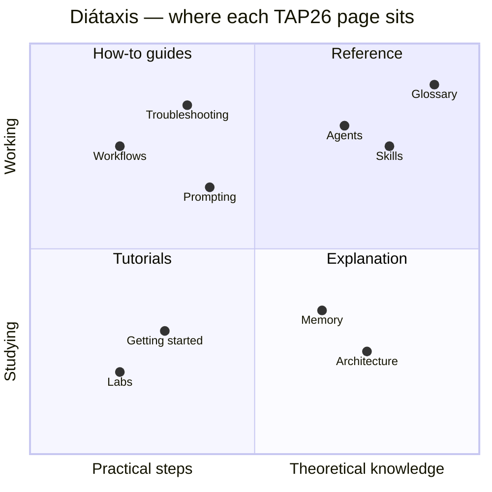

# TAP26-Junior documentation — index

Welcome. This folder explains **how TAP26-Junior works and how to use it** while you learn agentic
development and testing on the Cypress Real World App (RWA). If you have not opened the framework yet,
read the [START HERE page](../README.md) first, then come back.

## Suggested reading order

| Step | Read | Then do | Time |
|---|---|---|---|
| 1 | [01 Getting started in VS Code](01-getting-started-vscode.md) | [Lab 01 — Setup](../labs/lab-01-setup.md), [Lab 02 — Run](../labs/lab-02-run.md) | 30 min |
| 2 | [02 Architecture](02-architecture.md) | [Lab 03 — Explore](../labs/lab-03-explore.md) | 30 min |
| 3 | [03 Agents](03-agents.md) and [12 Prompting guide](12-prompting-guide.md) | [Lab 04 — Ask the roles](../labs/lab-04-ask-roles.md) | 45 min |
| 4 | [07 Testing framework](07-testing-framework.md) | [Lab 05](../labs/lab-05-first-api-test.md), [Lab 06](../labs/lab-06-first-ui-test.md) | 90 min |
| 5 | [04 Skills](04-skills.md) and [06 Workflows](06-workflows.md) | [Lab 07](../labs/lab-07-api-change.md), [Lab 08](../labs/lab-08-ui-change.md), [Lab 09](../labs/lab-09-sync-tests.md) | 2–3 h |
| 6 | [08 API contract & Swagger](08-api-contract-and-swagger.md) | [Lab 10 — Swagger](../labs/lab-10-swagger.md) | 45 min |
| 7 | [09 Mocks & stubs](09-mocks-and-stubs.md) | [Lab 11 — Mocks](../labs/lab-11-mocks.md) | 45 min |
| 8 | [06 Workflows](06-workflows.md) (E2E + debugging) | [Lab 12](../labs/lab-12-e2e-journey.md), [Lab 13](../labs/lab-13-debugging.md) | 2 h |
| 9 | [05 Memory & self-learning](05-memory-and-self-learning.md) | [Lab 14 — Docs](../labs/lab-14-docs.md) | 45 min |
| 10 | [10 Hooks & guardrails](10-hooks-and-guardrails.md) and [11 Evolving TAP26](11-evolving-tap26.md) | [Lab 15 — Evolve](../labs/lab-15-evolve.md) | 90 min |

Keep [13 Troubleshooting](13-troubleshooting.md), [14 FAQ](14-faq.md) and the [Glossary](glossary.md)
open in a tab — you will need them.

## Diátaxis map

The docs follow the [Diátaxis](https://diataxis.fr/) framework: four kinds of documentation for four
different needs. Knowing which kind you are reading helps you skim the right way.

| Kind | Purpose | Pages |
|---|---|---|
| **Tutorials** (learning by doing) | Guided, safe, step-by-step | [Labs 01–15](../labs/lab-01-setup.md), [01 Getting started](01-getting-started-vscode.md) |
| **How-to guides** (solving a task) | Recipes for a real goal | [06 Workflows](06-workflows.md), [08 Swagger](08-api-contract-and-swagger.md), [09 Mocks](09-mocks-and-stubs.md), [11 Evolving](11-evolving-tap26.md), [12 Prompting](12-prompting-guide.md), [13 Troubleshooting](13-troubleshooting.md) |
| **Reference** (looking things up) | Complete, dry, accurate | [03 Agents](03-agents.md), [04 Skills](04-skills.md), [07 Testing framework](07-testing-framework.md), [Glossary](glossary.md), [BLUEPRINT](../BLUEPRINT.md) |
| **Explanation** (understanding why) | Concepts and design reasons | [02 Architecture](02-architecture.md), [05 Memory](05-memory-and-self-learning.md), [10 Hooks](10-hooks-and-guardrails.md), [14 FAQ](14-faq.md) |

## All pages

| # | Page | One-line summary |
|---|---|---|
| 00 | this page | reading order and map |
| 01 | [Getting started in VS Code](01-getting-started-vscode.md) | prerequisites, the `tap26-base` branch, first run, panel vs terminal, permissions, tasks |
| 02 | [Architecture](02-architecture.md) | the layers of TAP26 and why each exists |
| 03 | [Agents](03-agents.md) | the 24 agents, when to use each, hand-off format |
| 04 | [Skills](04-skills.md) | all 31 `/tap-*` commands with syntax and examples |
| 05 | [Memory & self-learning](05-memory-and-self-learning.md) | shared memory, digest, ledger, learning loop, `memory.mjs` |
| 06 | [Workflows](06-workflows.md) | step-by-step recipes for the most common jobs |
| 07 | [Testing framework](07-testing-framework.md) | the functional Playwright framework in `playwright/` |
| 08 | [API contract & Swagger](08-api-contract-and-swagger.md) | OpenAPI, drift checks, Swagger UI on :3100 |
| 09 | [Mocks & stubs](09-mocks-and-stubs.md) | mock server on :3101, `stubApi`, factories |
| 10 | [Hooks & guardrails](10-hooks-and-guardrails.md) | what runs automatically, and how to control it |
| 11 | [Evolving TAP26](11-evolving-tap26.md) | change the framework itself, safely |
| 12 | [Prompting guide](12-prompting-guide.md) | how to ask agents well |
| 13 | [Troubleshooting](13-troubleshooting.md) | symptoms → fixes |
| 14 | [FAQ](14-faq.md) | short answers to common questions |
| — | [Glossary](glossary.md) | agentic, testing and domain terms |

## Conventions used in these docs

- `Code style` = a path, command or identifier you can type exactly.
- `/tap-…` = a slash command typed in the Claude Code prompt box.
- **Try it** boxes are short exercises you can do in under five minutes:

> **Try it** — Open the Claude panel and type `/tap-status`. Compare what it shows with the
> `tap26/memory/MEMORY.md` file. Which sections match?

- All paths are relative to the repository root unless stated otherwise.
- Ports: UI **3000**, API **3001**, Swagger UI **3100**, mock API **3101**.
