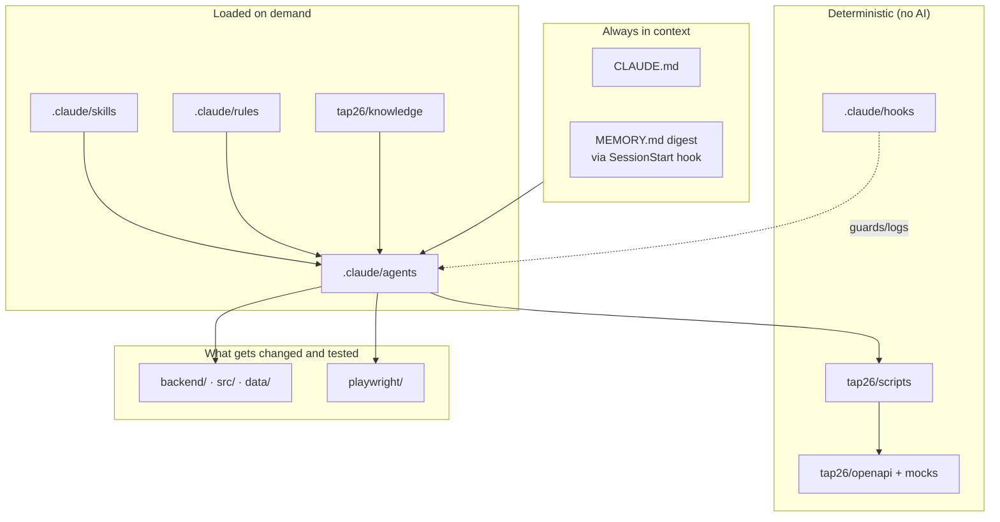
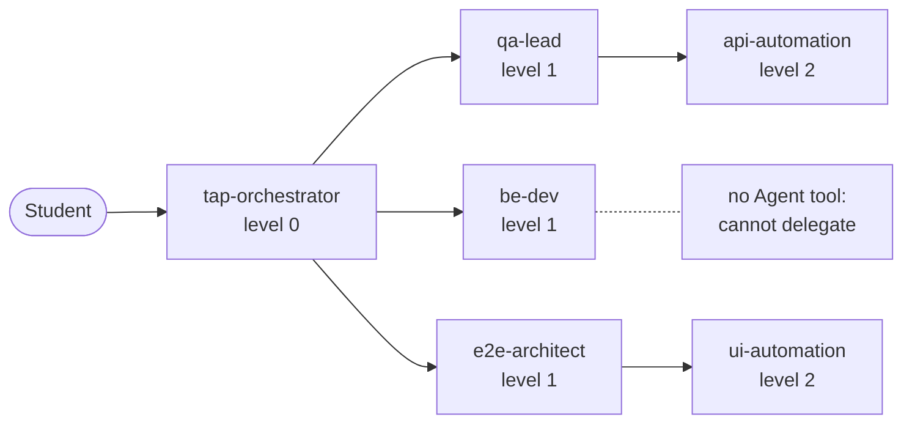
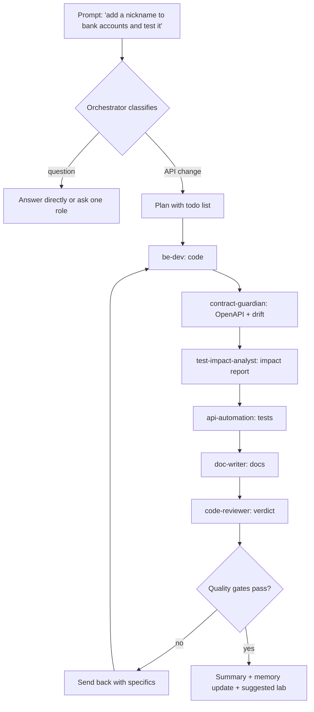
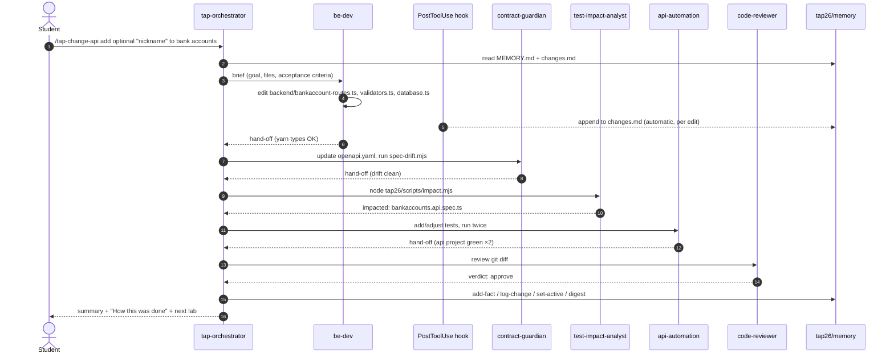

# 02 · Architecture

TAP26-Junior is not one big prompt. It is a set of **layers**, each solving one problem that appears
when you let AI agents work on a real codebase. This page explains every layer, shows how a request
flows through them, and teaches the concepts behind the design.

## The layers at a glance

| # | Layer | Lives in | Loaded when | Problem it solves |
|---|---|---|---|---|
| 1 | Project instructions | `CLAUDE.md` | every session, always | shared ground rules: commands, conventions, orchestrator protocol |
| 2 | Path-scoped rules | `.claude/rules/*.md` | when a matching file is read/edited (`paths:` frontmatter) | detailed conventions only when relevant (backend, frontend, playwright, openapi) |
| 3 | Agents | `.claude/agents/*.md` | when delegated to | specialist expertise with its own context window and tools |
| 4 | Skills | `.claude/skills/tap-*/SKILL.md` | when you type `/tap-…` (or Claude picks one) | repeatable, quality-gated pipelines |
| 5 | Hooks | `.claude/hooks/*.mjs` + `.claude/settings.json` | on events (session start, before Bash, after edits…) | deterministic guardrails and automatic logging |
| 6 | Shared memory | `tap26/memory/` | digest imported by `CLAUDE.md` at session start; files read on demand | continuity between sessions and agents |
| 7 | Knowledge | `tap26/knowledge/` (+ `generated/`) | read by agents in "Before you start" | a map of the app so agents don't re-discover it |
| 8 | Scripts (tools) | `tap26/scripts/*.mjs` | called via Bash | deterministic work: doctor, scan, impact, drift, servers |
| 9 | Contract & mocks | `tap26/openapi/`, `tap26/mocks/`, `tap26/swagger/` | API work, Swagger, mocking | a single source of truth for the API |
| 10 | Test framework | `playwright/` | test work | functional Playwright suite: api, ui-desktop, ui-mobile |

## Concept 1 — the context window

An LLM can only "see" a limited amount of text at once: its **context window**. Everything — your
prompt, files it read, command output, the conversation so far — competes for that space. When it fills
up, older details get summarised (compacted) and nuance is lost.

TAP26 protects the context window by:

- keeping `CLAUDE.md` and the memory digest **short** (the digest is capped at ~120 lines);
- loading rules and skills **only when needed**;
- giving each **agent its own fresh context window**: a subagent reads 20 files, and only its short
  hand-off report comes back to the orchestrator.

## Concept 2 — delegation and depth ≤ 3

The orchestrator delegates with the `Agent` tool. A subagent works in isolation and returns a
**hand-off report**. Delegation can nest — orchestrator → `qa-lead` → `api-automation` — but TAP26 caps
it at **three levels**, and only `tap-orchestrator`, `qa-lead` and `e2e-architect` have the `Agent` tool
at all. Why? Deep chains are slow, expensive, hard to debug, and every hop loses detail (like a game of
telephone).

## Concept 3 — least privilege

Each agent gets **only the tools its job needs** (`tools:` in its frontmatter). `code-reviewer` and
`tutor` cannot edit files, so a review can never "fix" code silently. Builders can edit and run Bash,
but hooks still block destructive commands. This is the same principle as giving a CI job a read-only token.

## Concept 4 — deterministic tools beat clever prompts

Anything that must be *exactly right every time* — parsing routes, comparing the OpenAPI spec with
Express, formatting memory entries, blocking `git push --force` — is a **script or a hook**, not an
instruction. Agents decide *what* to do; scripts do it reproducibly. All scripts are zero-dependency
Node (`.mjs`) so they run the same on Windows, macOS and Linux; hooks are registered in exec form
(`node` + script path, no shell in between).

## Concept 5 — memory outside the model

Models forget between sessions. TAP26 writes what matters into plain Markdown files in
`tap26/memory/`. `CLAUDE.md` imports the digest (`@tap26/memory/MEMORY.md`) into every new session,
and a **SessionStart hook** adds app health and today's change ledger. See
[05 Memory & self-learning](05-memory-and-self-learning.md).

## Delegation flow for a typical request

## Sequence: an API change end to end

## Why each layer exists — summary

| If we removed… | …this would go wrong |
|---|---|
| `CLAUDE.md` | every session starts from zero; commands and conventions are guessed |
| rules | huge `CLAUDE.md` wastes context on irrelevant details |
| agents | one context window fills up; no specialist standards; no independent review |
| skills | you'd have to retype the pipeline and gates every time |
| hooks | safety and logging depend on the model remembering to do them |
| memory | lessons are relearned, decisions re-argued |
| knowledge | agents re-scan the codebase each time (slow, costly) |
| scripts | non-deterministic results; platform-specific shell snippets |
| OpenAPI | docs, mocks and tests drift apart |

> **Try it** — Ask: *"Which layers of TAP26 were involved when you answered my last question? Name the
> files."* Then open one of the files it names and check.

Next: [03 Agents](03-agents.md). Hands-on: [Lab 03 — Explore](../labs/lab-03-explore.md).
