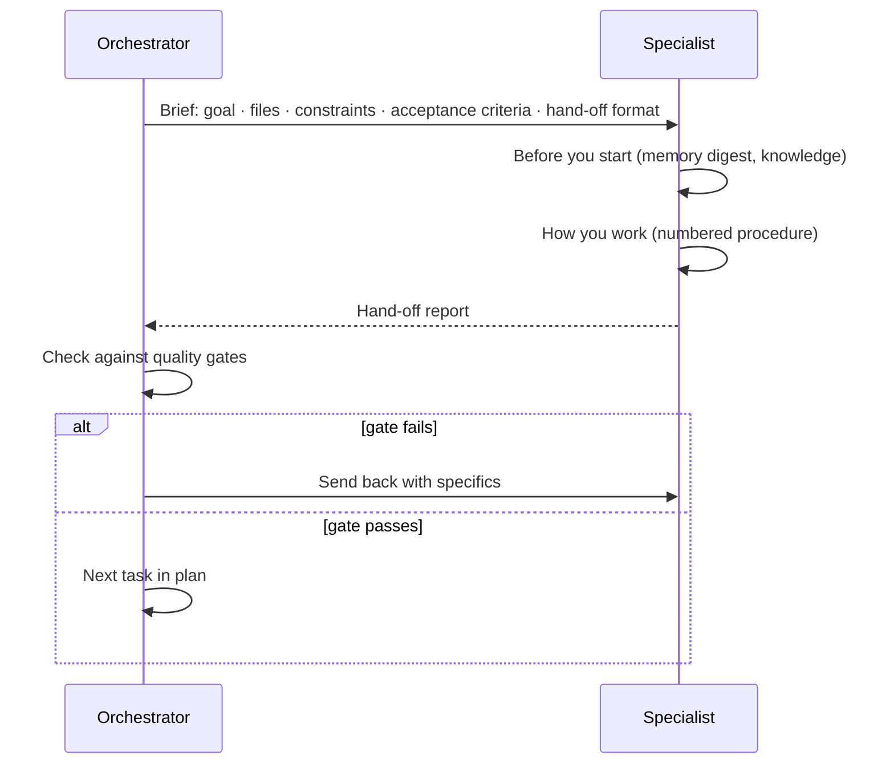

# 03 · Agents

An **agent** (Claude Code calls them *subagents*) is a Markdown file in `.claude/agents/` with a
frontmatter header (name, description, tools, model, colour, memory) and a body that tells it how to
work. When an agent runs, it gets a **fresh context window**, only the tools listed in its frontmatter,
and its own instructions. When it finishes, it returns a **hand-off report** to whoever called it.

TAP26 has **24 agents**: one orchestrator and 23 specialists.

## How to call an agent

| Way | Example |
|---|---|
| Describe the task (orchestrator routes it) | *"Why does POST /transactions return 422 when amount is 0?"* |
| Name the agent | *"Use the **debugger** agent to find out why `auth.spec.ts` fails on mobile."* |
| Ask a role via skill | `/tap-ask security is the /users/:id endpoint vulnerable to IDOR?` |
| Run a skill that uses it | `/tap-a11y signin` → `a11y-auditor` |
| Start a CLI session as it | `claude --agent tap-orchestrator` (terminal) |

You can see all agents by typing `/agents` in the prompt box (CLI) or browsing `.claude/agents/`.

**Tools legend:** R = Read, G = Grep, Gl = Glob, E = Edit, W = Write, B = Bash, Web = WebSearch +
WebFetch, A = Agent (can delegate). The frontmatter of each file is the authoritative list.

## Lead

| Agent | Role | Use when | Tools | Example prompt | Outputs |
|---|---|---|---|---|---|
| `tap-orchestrator` | Conductor: classifies, plans, delegates, enforces gates, updates memory | anything spanning more than one role or step | all (incl. A) | "Add a 'note' field to bank accounts and cover it with tests" | plan, consolidated summary, memory updates |

## Development

| Agent | Role | Use when | Tools | Example prompt | Outputs |
|---|---|---|---|---|---|
| `be-dev` | Express routes, validators, lowdb `database.ts`, GraphQL, seed; keeps OpenAPI in step | API behaviour changes or "why does the API do X" | R G Gl E W B | "Add GET /notifications/unread-count" | `backend/**`, `openapi.yaml`, change-ledger lines |
| `fe-dev` | React/MUI components, XState machines, routing, Formik/Yup forms; preserves `data-test` | UI changes | R G Gl E W B | "Disable the Save button until the form is valid" | `src/**` with `data-test` attributes |
| `env-ops` | Install, versions, ports, running app/tests, CI, doctor | environment errors, setup, CI | R G Gl E W B | "Port 3001 is busy, fix it" | doctor results, config/CI files |
| `debugger` | Reproduce → isolate → trace → fix proposal | something is broken or flaky | R G Gl E W B | "transaction-feeds.spec.ts is flaky" | root-cause report, minimal fix |

## Test automation

| Agent | Role | Use when | Tools | Example prompt | Outputs |
|---|---|---|---|---|---|
| `api-automation` | Playwright API tests using `playwright/src/api/*` | new/changed API tests | R G Gl E W B | "Test that PATCH /users/:id rejects an invalid email" | `playwright/tests/api/*.api.spec.ts` |
| `ui-automation` | Playwright UI tests using `src/ui/*` helpers and fixtures | new/changed UI tests | R G Gl E W B | "Test the bank-account delete flow on mobile" | `playwright/tests/ui/*.spec.ts` |
| `e2e-architect` | Cross-layer journeys, suite structure, tagging, sharding | multi-step user journeys, suite design | R G Gl E W B A | "Design a journey: sign up → add bank account → pay a contact" | `playwright/tests/e2e/*.e2e.spec.ts`, tagging plan |
| `test-impact-analyst` | Turns diffs + change ledger into an impact report and update plan | after any app change | R G Gl E W B | "Which tests are affected by my changes since tap26-base?" | impact report in `tap26/reports/impact/` |
| `contract-guardian` | Owns `tap26/openapi/*`, drift detection, contract tests, Swagger UI | API spec work | R G Gl E W B | "Check the spec matches the Express routes" | `openapi.yaml/json`, drift report, contract tests |
| `mock-smith` | Mock server scenarios, stub builders, factories, fixtures | isolating the UI from the API, edge-case data | R G Gl E W B | "Create a scenario where /transactions returns 500" | `tap26/mocks/**`, `playwright/src/mocks/**` |

## Quality and specialist testing

| Agent | Role | Use when | Tools | Example prompt | Outputs |
|---|---|---|---|---|---|
| `manual-tester` | Exploratory charters, test cases, bug reports, session notes | thinking like a human tester | R G Gl E W B | "Write an exploratory charter for payments" | test cases, charters, bug reports |
| `data-tester` | Test data design, DB integrity, seed analysis, boundary data | data questions, data-driven tests | R G Gl E W B | "Do all transactions reference existing users?" | integrity report, data sets |
| `qa-lead` | Strategy, risk-based plans, coverage matrix, release readiness | deciding *what* and *how much* to test | R G Gl E W B A | "Are we ready to release the notifications change?" | test plan, coverage matrix, readiness report |
| `a11y-auditor` | axe-core + manual WCAG 2.2 checks, a11y tests | accessibility | R G Gl E W B | "Audit the sign-up form" | audit report, a11y tests |
| `security-tester` | AppSec checks (OWASP lens), local and safe only | security questions | R G Gl E W B | "Can user A read user B's transactions?" | findings report, security tests |
| `perf-tester` | API latency baselines, Web Vitals | performance | R G Gl E W B | "Baseline p95 for GET /transactions" | `perf-smoke` results, report |

## Analysis, design and documentation

| Agent | Role | Use when | Tools | Example prompt | Outputs |
|---|---|---|---|---|---|
| `business-analyst` | Stories, Gherkin acceptance criteria, flows, traceability | defining *what* to build | R G Gl E W Web | "Write a story for splitting a payment" | story + Gherkin in `tap26/reports/ba/` |
| `ux-designer` | Heuristic reviews, flows, copy, wireframes, design specs | before UI changes | R G Gl E W Web | "Review the new-transaction flow" | UX review, wireframe, spec for fe-dev |
| `doc-writer` | READMEs, ADRs, release notes, API guides, `tap26/docs` | after user-visible changes | R G Gl E W B | "Update the docs for the nickname field" | docs updates |
| `code-reviewer` | Independent, read-only review of a diff | before you commit | R G Gl B (git) | "Review my current diff" | verdict + findings |
| `researcher` | Codebase investigations, web research, comparisons | open questions, "compare X vs Y" | R G Gl E W Web | "Compare Playwright fixtures with Cypress custom commands" | cited report |

## Learning and self-improvement

| Agent | Role | Use when | Tools | Example prompt | Outputs |
|---|---|---|---|---|---|
| `tutor` | Explains, gives Socratic hints, quizzes, reviews kindly | you want to *learn*, not just get it done | R G Gl Web | "Give me a hint for lab 05, not the answer" | explanations, hints, quizzes |
| `knowledge-curator` | Curates memory, runs retros, proposes/applies evolutions | end of a session, improving TAP26 | R G Gl E W B | "Run a retro on today's work" | learnings, proposals, CHANGELOG |

> **Try it** — Ask the same question to two roles and compare:
> `/tap-ask manual what should I check on the bank accounts page?` then
> `/tap-ask security what should I check on the bank accounts page?`

## How agents hand off

Specialists never talk to each other directly. Each returns a report to its caller (usually the
orchestrator), which checks it and decides the next step. Every report uses this exact format:

```markdown
## Hand-off — be-dev
Status: done | partial | blocked
Changed files: backend/bankaccount-routes.ts, backend/validators.ts, tap26/openapi/openapi.yaml
Verification: yarn types → 0 errors; curl POST /bankAccounts with nickname → 200
Risks / follow-ups: GraphQL createBankAccount mutation does not accept nickname yet
Memory updated: changes.md (2 lines), F: "[api] nickname optional, max 40 chars"
Next suggested agent: test-impact-analyst
```

| Field | Why it matters |
|---|---|
| Status | `partial`/`blocked` makes the orchestrator re-plan instead of pretending it's done |
| Changed files | the exact list you should review in Source Control |
| Verification | evidence (commands + counts), not "should work" |
| Risks / follow-ups | what is knowingly left open |
| Memory updated | ids of facts/learnings/decisions so they can be found later |
| Next suggested agent | keeps pipelines flowing |



## Anatomy of an agent file

Every agent body has the same nine sections, in order: mission, *You are consulted for*, *Before you
start*, *How you work*, *Standards*, *Outputs*, *Memory duties*, *Boundaries*, *Teaching mode*. Open
`.claude/agents/be-dev.md` to see a full example. To write your own, see
[11 Evolving TAP26](11-evolving-tap26.md).

Next: [04 Skills](04-skills.md). Hands-on: [Lab 04 — Ask the roles](../labs/lab-04-ask-roles.md).
