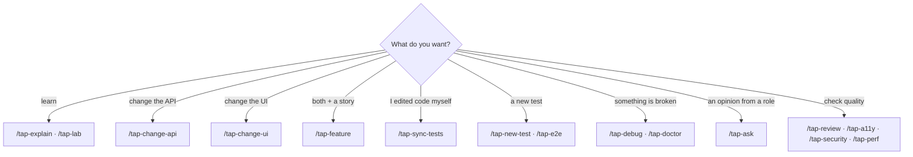

# 04 · Skills (slash commands) reference

A **skill** is a folder in `.claude/skills/<name>/` with a `SKILL.md` file. Each TAP26 skill is a
slash command: type `/` in the Claude prompt box, start typing `tap-`, pick one, and add arguments after
it. Inside the skill, `$ARGUMENTS` is replaced by whatever you typed after the name.

Every TAP26 skill has the same sections: **Goal**, **Inputs**, **Steps** (naming the agent for each
step), **Quality gates**, **Output**, **Memory**, **Learn more**. Open any `SKILL.md` to see exactly what
it will do before you run it.

```
/tap-change-api add optional "nickname" (max 40 chars) to POST /bankAccounts
└──────┬─────┘ └──────────────────────────┬─────────────────────────────────┘
   skill name                 $ARGUMENTS (free text)
```

Notation: `<required>`, `[optional]`, `a|b` = choose one.

## Getting started and environment

| Command & syntax | Example | What happens | Outputs |
|---|---|---|---|
| `/tap-start [your level/goal]` | `/tap-start new to Playwright` | doctor (read-only) → 10-line tour → 5 commands → next lab | onboarding summary, journal line |
| `/tap-setup [--seed] [--with-cypress] [--skip-app\|--skip-playwright]` | `/tap-setup` | checks Node/Yarn, installs app deps (no Cypress binary), Playwright + Chromium, runs doctor | installed deps, doctor table |
| `/tap-run [app\|swagger\|mock\|all]` | `/tap-run all` | starts `yarn dev` in the background, waits for :3000/:3001, optionally Swagger :3100 and mocks :3101 | URLs + a seeded login |
| `/tap-doctor [symptom]` | `/tap-doctor port 3001 in use` | `env-ops` runs `doctor.mjs`; `debugger` explains any FAIL | PASS/WARN/FAIL table + fixes |
| `/tap-status [full]` | `/tap-status full` | orchestrator shows app health, memory digest highlights, recent ledger changes, open questions | dashboard in chat |
| `/tap-scan` | `/tap-scan` | runs `scan-app.mjs` to refresh routes, selectors, UI routes, test inventory, coverage matrix | `tap26/knowledge/generated/*.md` |

## Changing the app (with tests and docs)

| Command & syntax | Example | What happens | Outputs |
|---|---|---|---|
| `/tap-change-api <what to change>` | `/tap-change-api fix KI-01: DELETE /contacts/{unknown id} must return 404 and delete nothing` | `be-dev` → `contract-guardian` (spec + drift) → `test-impact-analyst` → `api-automation` → `doc-writer` → `code-reviewer` | code, `openapi.yaml/json`, tests, docs, review verdict |
| `/tap-change-ui <what to change>` | `/tap-change-ui add a "Copy link" button to the transaction detail page` | (`ux-designer`) → `fe-dev` → `test-impact-analyst` → `ui-automation` → `doc-writer` → `code-reviewer` | `src/**` with `data-test`, UI tests, docs, verdict |
| `/tap-feature <feature description>` | `/tap-feature users can add a memo to bank transfers` | `business-analyst` (story + Gherkin) → `be-dev` → `fe-dev` → `qa-lead` → testers → `doc-writer` → `code-reviewer` | story, code, tests, docs |
| `/tap-sync-tests [--since <git ref>]` (default: uncommitted changes + ledger) | `/tap-sync-tests --since tap26-base` | `impact.mjs` on the diff + change ledger → `test-impact-analyst` plan → `api/ui-automation` update tests | impact report, updated tests |

## Writing and running tests

| Command & syntax | Example | What happens | Outputs |
|---|---|---|---|
| `/tap-new-test api\|ui\|e2e "<what the test should prove>"` | `/tap-new-test ui "a user can delete a bank account on mobile"` | routed to `api-automation`, `ui-automation` or `e2e-architect`; test written, run twice, typechecked | new spec in `playwright/tests/**` |
| `/tap-run-tests [api\|ui\|mobile\|e2e\|all\|unit\|cypress] [spec file or grep text]` | `/tap-run-tests api bank` | `env-ops` runs Playwright, summarises counts; `debugger` triages failures | pass/fail summary, triage notes, HTML report |
| `/tap-e2e <journey>` | `/tap-e2e new user signs up, onboards a bank account and pays Arvilla` | `e2e-architect` designs steps (UI + API + data checks), may delegate to automation agents | `playwright/tests/e2e/*.e2e.spec.ts`, run with `--project=e2e` |
| `/tap-debug failing test <name\|file> \| error "<msg>" \| page <route> \| <symptom>` | `/tap-debug POST /comments returns 500 for long text` | `debugger`: reproduce → isolate → trace → propose minimal fix; owner applies it | root-cause report, fix, learning |
| `/tap-a11y [screen\|route\|all] [tests]` | `/tap-a11y signin tests` | `a11y-auditor` runs axe-core via Playwright + manual WCAG 2.2 checks | report in `tap26/reports/a11y/`, optional a11y tests |
| `/tap-security [auth\|idor\|validation\|headers\|graphql\|deps\|all \| <endpoint or feature>]` | `/tap-security idor` | `security-tester` runs safe local checks (authn/z, IDOR, validation, headers, dependency audit); KI-04…KI-09 are the classic findings | findings report |
| `/tap-perf [api\|ui\|all] [endpoint or screen] [compare]` | `/tap-perf api /transactions` | `perf-tester` runs `perf-smoke.mjs` (p50/p95) and optional Web Vitals | latency table, report |

## Contract, mocks and data

| Command & syntax | Example | What happens | Outputs |
|---|---|---|---|
| `/tap-swagger [all\|regen\|lint\|drift\|serve]` (default: all) | `/tap-swagger drift` | `contract-guardian` regenerates `openapi.json`, lints, runs `spec-drift.mjs`, can start Swagger UI on :3100 | spec files, drift report |
| `/tap-mocks server <scenario> \| stub <METHOD /endpoint> <state> \| factory <entity> \| fixture <entity>` | `/tap-mocks stub GET /notifications empty` | `mock-smith` adds mock-server scenarios, Playwright stubs, factories | `tap26/mocks/**`, `playwright/src/mocks/**` |
| `/tap-data inspect <entity> \| integrity \| reset \| generate <entity> <n> [apply] \| boundaries <field>` | `/tap-data integrity` | `data-tester` inspects `data/database.json`, generates data, resets (asks first!), integrity checks | data report or data sets |

## Thinking like a team (roles, plans, docs)

| Command & syntax | Example | What happens | Outputs |
|---|---|---|---|
| `/tap-ask <role> <question>` | `/tap-ask ux is the "Pay / Request" choice clear?` | roles: `ux be fe ba manual data ui-auto api-auto qa security perf a11y docs devops research` → mapped agent answers in its voice | an answer, no file changes |
| `/tap-test-plan <feature or change>` | `/tap-test-plan bank-account nickname field` | `qa-lead` writes a risk-based plan (scope, risks, levels, data, entry/exit) | plan in `tap26/reports/test-plans/` |
| `/tap-test-cases <feature or screen> [steps\|gherkin\|charter]` | `/tap-test-cases transaction comments charter` | `manual-tester` writes test cases or exploratory charters from templates | test-case document |
| `/tap-bug <symptom> [verify] [regression api\|ui]` | `/tap-bug like count doesn't update until refresh verify` | `manual-tester` writes a reproducible report; `debugger` verifies if asked | bug report from `tap26/templates/` |
| `/tap-review [git ref range]` (default: uncommitted vs HEAD) | `/tap-review tap26-base..HEAD` | `code-reviewer` reads `git diff` against standards (read-only) | verdict + findings by severity |
| `/tap-docs <topic> \| all \| api \| changes [--since <ref>] \| release-notes [version]` | `/tap-docs changes --since tap26-base` | `doc-writer` creates/refreshes docs, ADRs, release notes | updated Markdown |
| `/tap-research <question> [quick\|deep]` | `/tap-research how should we tag tests for sharding in CI?` | `researcher` investigates codebase and web, cites sources | report in `tap26/reports/research/` |

## Learning and self-improvement

| Command & syntax | Example | What happens | Outputs |
|---|---|---|---|
| `/tap-explain <concept\|file\|function> [beginner\|intermediate\|advanced]` | `/tap-explain @playwright/src/fixtures/index.ts` | `tutor` explains with analogies, checks understanding with a question | explanation |
| `/tap-lab [NN] [check\|hint]` | `/tap-lab 05 hint` | `tutor` introduces the lab, gives graded hints, checks your work against checkpoints | coaching, no spoilers |
| `/tap-retro [session\|today\|lab-NN\|<topic>]` | `/tap-retro today` | `knowledge-curator` reads the journal, hand-offs and usage counters (`tap26/memory/.state/usage.json`), distils learnings | `learnings.md` entries, retro in `tap26/reports/retros/`, one row in `tap26/evolution/metrics.md`, refreshed digest |
| `/tap-evolve propose <idea> \| review \| apply EP-###` | `/tap-evolve propose ban hard waits in tests` | `knowledge-curator` turns learnings/ideas into proposals, `review` lists them, `apply` only after your approval | `tap26/evolution/proposals/*`; on apply: version bump in `CHANGELOG.md`, `tap26/README.md`, `tap26/package.json`, `TAP26_VERSION` (approval prompt), then `check-framework.mjs --strict` |

> **Try it** — Type `/tap-` and scroll the list. Pick one skill you have not used, open its
> `.claude/skills/<name>/SKILL.md`, and predict which agents it will call before running it.

## Which skill should I use?



## Tips

- Skills are just prompts with structure — you can always say the same thing in plain English.
- Arguments are free text; be specific (endpoint, screen, user, expected behaviour).
- Skills that change code always end with verification and a hand-off; read the **Changed files** list.
- Skills that reset data (`/tap-data reset`, `/tap-setup --seed`, any test run) wipe manual data.

Related: [03 Agents](03-agents.md) · [06 Workflows](06-workflows.md) · [12 Prompting guide](12-prompting-guide.md).
