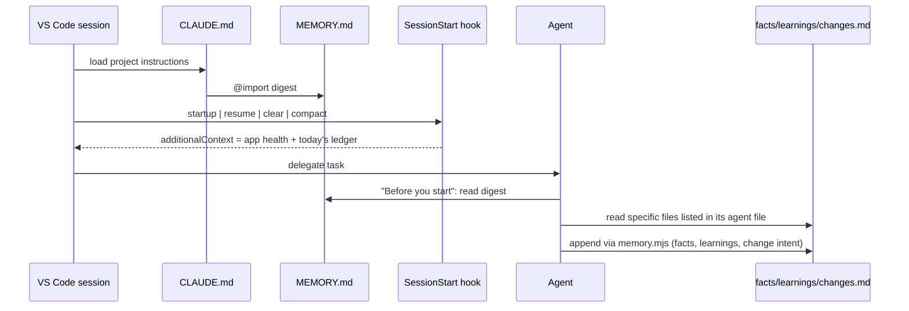
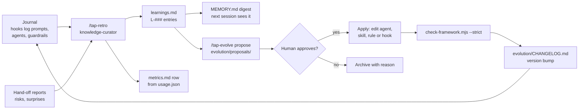

# 05 · Memory and self-learning

Language models do not remember anything between sessions. TAP26 gives its agents a memory made of
**plain Markdown files in git**, a **digest imported by `CLAUDE.md`** at every session start, a hook that **logs
every app edit**, and a **learning loop** that turns experience into better agents and skills.

## Two kinds of memory

| | Shared memory | Per-agent memory |
|---|---|---|
| Where | `tap26/memory/` | `.claude/agent-memory/<agent>/` |
| Who reads it | every agent and you | only that agent |
| Who writes it | agents via `memory.mjs`; hooks | the agent itself (Claude Code manages it, `memory: project` in frontmatter) |
| Holds | project facts, decisions, learnings, change ledger, questions, journal | agent-specific heuristics ("in this repo MUI inputs need `inputProps`…") |
| Promotion | — | general lessons get promoted to `learnings.md` by `knowledge-curator` |

## Shared memory files

| File | Purpose | Entry format |
|---|---|---|
| `MEMORY.md` | **digest** (≤ ~120 lines) imported by `CLAUDE.md` (`@tap26/memory/MEMORY.md`) | generated — do not hand-edit except *Conventions* |
| `facts.md` | stable, verified facts | `- [area] fact (verified YYYY-MM-DD by <agent>)` |
| `decisions.md` | ADR-lite decision log | `## D-### Title` + Context / Decision / Consequences / Date · By |
| `learnings.md` | lessons from mistakes and surprises | `## L-### Title` + Tags / What happened / Lesson / Applies to / Date · Source |
| `changes.md` | **change ledger** of app edits | `- YYYY-MM-DD HH:MM \| <file> \| <tool or summary> \| <agent/session>` |
| `open-questions.md` | unresolved questions | `- [ ] Q-### question (asked by, date)` → `- [x]` + `- Answer: …` |
| `glossary.md` | domain and testing terms | `- **Term** — definition` |
| `journal/YYYY-MM-DD.md` | session journal — **local only (gitignored)** | `- HH:MM [agent] text` |
| `.state/` | hook state, e.g. `usage.json` (skill/agent usage counters) — **local only (gitignored)** | JSON, written by hooks |

### What is committed and what stays local

Everything in `tap26/memory/` is committed **except** `journal/` and `.state/`. The journal records your
prompts word for word, so it stays on your machine. `/tap-retro` summarises it into tracked files: learnings
in `learnings.md`, the retro report in `tap26/reports/retros/` and any bug reports in `tap26/reports/bugs/`
(both folders are committed; other `tap26/reports/` subfolders are not). That is why `git add -A` at the end
of a lab is safe: your raw prompts are never part of the commit.

Example entries:

```markdown
- [auth] Auth is a session cookie `connect.sid` from POST /login (verified 2026-10-16 by tap26-setup)

## L-004 Start waiting for a response before the action
- Tags: playwright, network
- What happened: waitForApi was awaited after the click and missed the response
- Lesson: `const res = waitForApi(page, …); await action(); await res;`
- Applies to: ui-automation, e2e-architect
- Date: 2026-10-16 · Source: ui-automation
```

**Rules:** append via `memory.mjs` only (consistent format); never delete someone else's entry —
mark it superseded instead; never store secrets (memory is committed, apart from `journal/` and `.state/`).

## How memory reaches an agent

The digest reaches every session in two ways:

1. **`CLAUDE.md` imports it** — the last line of `CLAUDE.md` is `@tap26/memory/MEMORY.md`, so the digest
   is loaded with the project instructions at every session start, even if hooks are disabled.
2. **The SessionStart hook** (`.claude/hooks/session-start.mjs`, on `startup|resume|clear|compact`) adds
   live context next to it: a TAP26 banner, port health for 3000/3001/3100/3101, today's change-ledger
   lines and a reminder of how to record memory.



The digest is rebuilt by `node tap26/scripts/memory.mjs digest`. It keeps the *Conventions* and
*Active work* sections, and pulls the last 25 facts, 5 decisions, 10 learnings, 8 ledger lines and 5
open questions from the full files.

## The change ledger

When an agent (or you, through Claude) edits a file under `backend/`, `src/` or a seed file in `data/`,
the **PostToolUse hook** `.claude/hooks/change-ledger.mjs` appends a line to `tap26/memory/changes.md`,
classified by area (`api-route`, `api-validation`, `api-data`, `graphql`, `state-machine`, `model`,
`frontend`, `seed`):

```
- 2026-10-16 14:02 | backend/bankaccount-routes.ts | Edit (api-route) | be-dev
```

The first time a file is touched in a session, the hook also tells Claude the follow-ups the change
implies (e.g. *"API route changed → update openapi.yaml, run spec-drift.mjs, then /tap-sync-tests"*).
Edits to `playwright/` tests or `openapi.yaml` get a reminder but no ledger line.

Agents add an *intent* line with `memory.mjs log-change` so the ledger says *why*, not just *what*.
`test-impact-analyst` and `impact.mjs` read the ledger together with `git diff` to decide which tests
must change. That is how `/tap-sync-tests` works even if you edited code by hand in Claude.

> Edits you make **directly in the VS Code editor** do not pass through Claude's tools, so the hook does
> not see them. `git diff` still does — that is why `impact.mjs` uses both.

## The learning loop



1. **Journal** — `journal.mjs` (UserPromptSubmit, SubagentStop) appends each prompt, finished subagent and guardrail decision to `journal/<date>.md`, and counts skill/agent usage in `tap26/memory/.state/usage.json`. Both stay local (gitignored).
2. **Retro** — `/tap-retro` makes `knowledge-curator` read the journal, hand-offs and failures, writes a
   retro report to `tap26/reports/retros/` and appends a row to `tap26/evolution/metrics.md` using the
   usage counters in `tap26/memory/.state/usage.json`.
3. **Learnings** — it distils them into `L-###` entries with *Applies to* (which agents/skills).
4. **Evolution proposals** — `/tap-evolve propose <idea>` turns repeated learnings into concrete diffs to agent
   or skill files, saved in `tap26/evolution/proposals/`.
5. **Approval** — a human (you or your instructor) approves. Nothing changes the framework silently.
6. **Apply + record** — `/tap-evolve apply` makes the curator apply the change and bump the version in
   `tap26/evolution/CHANGELOG.md`, `tap26/README.md`, `tap26/package.json` and `TAP26_VERSION` in
   `.claude/settings.json` (a protected file, so you get an approval prompt).
7. **Verify** — after **any** framework change (agent, skill, rule, hook, doc or lab), run
   `node tap26/scripts/check-framework.mjs --strict` (VS Code task **TAP: Framework check**). It checks
   frontmatter, slash-command and agent references, paths, links, JSON files and hook wiring, and must
   finish with no errors or warnings.

## `memory.mjs` CLI reference

Run from the repo root. `--by <agent>` sets the author (defaults to `$TAP26_AGENT` or `student`).

| Command | Example |
|---|---|
| `digest` | `node tap26/scripts/memory.mjs digest` |
| `show [file]` | `node tap26/scripts/memory.mjs show learnings.md` |
| `search <text>` | `node tap26/scripts/memory.mjs search seed` |
| `add-fact <area> <text>` | `node tap26/scripts/memory.mjs add-fact api "GET /bankAccounts returns only the caller's accounts" --by be-dev` |
| `add-learning <title> --lesson "…"` | `node tap26/scripts/memory.mjs add-learning "Formik validates on blur" --lesson "Use fillAndBlur before asserting helper text" --tags forms,ui --applies ui-automation` |
| `add-decision <title> --context "…" --decision "…"` | `node tap26/scripts/memory.mjs add-decision "Tag E2E specs" --context "CI is slow" --decision "Use @e2e tag and shard"` |
| `add-question <text>` | `node tap26/scripts/memory.mjs add-question "Should notifications be paginated?"` |
| `answer <Q-id> <text>` | `node tap26/scripts/memory.mjs answer Q-001 "Keep Cypress as a reference"` |
| `log-change <file> <summary>` | `node tap26/scripts/memory.mjs log-change backend/validators.ts "nickname max 40" --by be-dev` |
| `journal <text>` | `node tap26/scripts/memory.mjs journal "finished lab 05"` |
| `set-active <text>` | `node tap26/scripts/memory.mjs set-active "Lab 07: nickname on bank accounts"` |

Also available as `npm --prefix tap26 run -s tap:memory -- <command> …`, `npm --prefix tap26 run -s tap:digest`, and the *TAP: Memory digest* task.

> **Try it** — Add a fact you verified yourself, rebuild the digest and start a new Claude session
> (`/clear`). Ask *"What do you know about <your area>?"* — the agent should quote your fact.
>
> ```bash
> node tap26/scripts/memory.mjs add-fact ui "The Sign In button is disabled until both fields are filled"
> node tap26/scripts/memory.mjs digest
> ```

## Good memory hygiene

- **Facts must be verified** — include how (request, test, file read). Unverified ideas go to open questions.
- **Learnings must be actionable** — "Use X when Y", not "this was hard".
- **Keep the digest small** — if it grows past ~120 lines, run `/tap-retro` to consolidate.
- **Supersede, don't delete** — add "(superseded by L-012)" to old entries.

Next: [06 Workflows](06-workflows.md). Hands-on: [Lab 14 — Docs](../labs/lab-14-docs.md) and
[Lab 15 — Evolve](../labs/lab-15-evolve.md).
