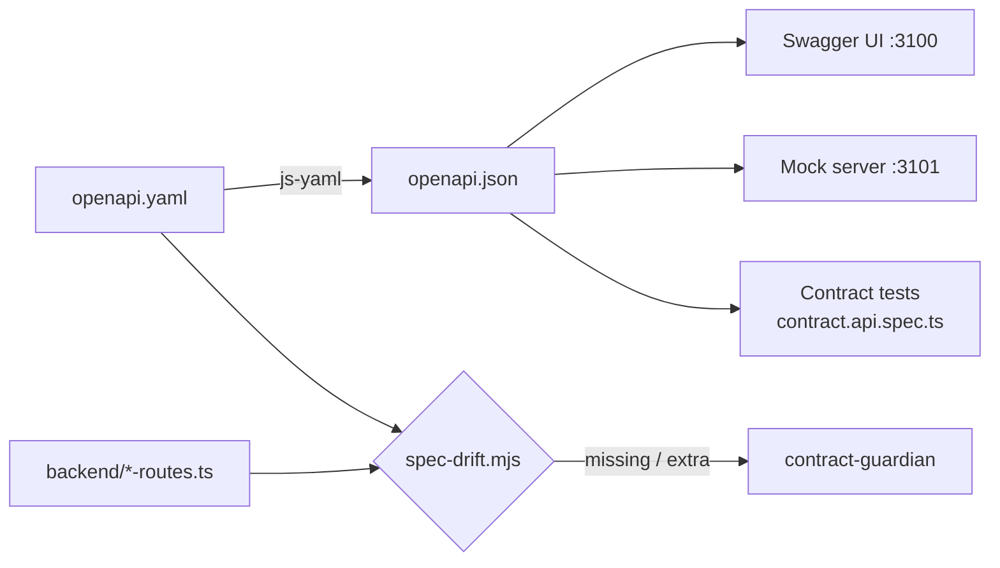

# 08 · API contract and Swagger UI

The RWA backend has no official API documentation. TAP26 adds one: an **OpenAPI 3.0.3** contract in
`tap26/openapi/`, verified against the running server, served through **Swagger UI**, and kept honest by
a **drift check** and **contract tests**. The owner is the `contract-guardian` agent.

## Files

| File | Role | Edit? |
|---|---|---|
| `tap26/openapi/openapi.yaml` | **source of truth** (paths, schemas, examples, security) | yes — by hand or via `contract-guardian` |
| `tap26/openapi/openapi.json` | generated from the YAML; used by Swagger UI, mocks, contract tests | **never by hand** |
| `tap26/openapi/CHANGELOG.md` | version history of the contract | append on every change |
| `tap26/swagger/index.html` | the Swagger UI page | rarely |
| `tap26/scripts/swagger-server.mjs` | serves the UI on :3100 and proxies `/api/*` → :3001 | no |
| `tap26/scripts/spec-drift.mjs` | compares spec paths/methods with Express routes | no |

The spec documents ~25 paths / 35 operations: auth (`/login`, `/logout`, `/checkAuth`), users,
contacts, bank accounts, bank transfers, transactions (personal, contacts, public feeds), likes,
comments, notifications, `/graphql` and the dev-only `/testData` routes.

## Why "source of truth" matters



If the docs, the mocks and the tests all derive from one file, they cannot silently disagree. If the
code moves without the spec, `spec-drift` catches it — that is quality gate 2.

## Everyday commands (from the repo root)

```bash
# regenerate JSON after editing the YAML
npx --yes js-yaml tap26/openapi/openapi.yaml > tap26/openapi/openapi.json

# lint the spec (Redocly)
npx --yes @redocly/cli@1 lint tap26/openapi/openapi.yaml

# drift: spec vs Express routes
node tap26/scripts/spec-drift.mjs            # or: npm --prefix tap26 run tap:drift

# serve Swagger UI on http://localhost:3100
node tap26/scripts/swagger-server.mjs        # or: npm --prefix tap26 run tap:swagger
```

Or let the agent do it: `/tap-swagger regen`, `/tap-swagger lint`, `/tap-swagger drift`, `/tap-swagger serve`.

## Why Swagger UI goes through a proxy

The API authenticates with a **session cookie** (`connect.sid`) and its CORS policy only allows the
origin `http://localhost:3000`. A Swagger page on `:3100` calling `:3001` directly would be blocked, and
the cookie would not be sent. So `swagger-server.mjs` serves the page **and** forwards `/api/*` to the
API on the same origin. The spec lists two servers:

| Server | Use |
|---|---|
| `/api` | **pick this in Swagger UI** — same-origin, cookies work |
| `http://localhost:3001` | direct (curl, Playwright, Postman) — CORS blocks browser use |

## Try-it-out walkthrough

1. Start the app (`/tap-run`) and Swagger UI (`/tap-run swagger` or the *TAP: Swagger UI* task).
2. Open http://localhost:3100. In the **Servers** dropdown choose **`/api`**.
3. **Reset data:** expand `POST /testData/seed` → *Try it out* → *Execute*. Expect `200` (plain `OK`).
4. **Log in first:** `POST /login` → *Try it out* → body:
   ```json
   { "username": "Heath93", "password": "s3cret" }
   ```
   *Execute* → `200` with the user. Your browser now holds the `connect.sid` cookie for :3100.
5. **Call a protected endpoint:** `GET /bankAccounts` → *Execute* → `200` with `{ "results": [ … ] }`.
6. **See an error shape:** `POST /bankAccounts` with `{}` → `422` and
   `{ "errors": [ { "msg", "param", "location" } ] }`.
7. **Log out:** `POST /logout` (it answers with a 302 redirect — KI-14), then repeat step 5 → `401 Unauthorized`.
8. When done, run `POST /testData/seed` again.

> **Try it** — Find one response in Swagger UI that contains something it should not (hint: look at the
> user objects returned by `/login`). Then look up **KI-07** in `tap26/knowledge/known-issues.md`.

## Reading the spec

- **Security:** `cookieAuth` (`in: cookie`, `name: connect.sid`) is the default; public operations
  (`/login`, `/logout`, `POST /users`, `/users/profile/{username}`, `/testData/*`, and — a defect,
  KI-08 — `GET /contacts/{username}`) override it with `security: []`.
- **Shapes:** lists are wrapped as `{ results: [...] }`; transaction feeds add `pageData`; amounts are
  integers in **cents**; ids are short strings; dates are ISO strings.
- **Shared components:** `components/schemas` (User, Transaction, BankAccount…), `components/responses`
  (`ValidationFailed` 422, `Unauthorized` 401, `ServerError`).
- **Reality, not wishes:** the spec documents what the server actually does, including known defects
  (with a KI reference). Planned endpoints are marked `x-status: planned`.

## GraphQL notes

Bank accounts are read and written by the UI through **GraphQL** (`POST /graphql`), not REST.

- Schema: `backend/graphql/schema.graphql` (also embedded in the spec's `/graphql` description).
- Send JSON: `{ "operationName": "ListBankAccount", "query": "query ListBankAccount { listBankAccount { id bankName } }" }`.
- Without a session you still get **200** — with an `errors` entry and `data: null` (KI-09).
- `GET /graphql` only serves the Playground page (KI-26). Use Swagger's `POST /graphql` or Playwright's
  `gqlListBankAccounts(api)` helper.
- In UI tests, match GraphQL calls by operation name:
  `waitForApi(page, { method: "POST", path: "/graphql", graphqlOperation: "CreateBankAccount" })`.

## Changing the contract

Every API change updates the YAML in the **same** change (gate 2). The `/tap-change-api` pipeline does
this for you: `be-dev` writes the code and an "API change note", `contract-guardian` updates the YAML,
regenerates JSON, lints, re-runs drift until clean, bumps `info.version` (patch = docs, minor =
additive, major = breaking) and appends to `tap26/openapi/CHANGELOG.md`.

## Contract tests

`playwright/tests/api/contract.api.spec.ts` validates real responses against the schemas in
`openapi.json` with AJV, one test per operation and status. They catch "the field is now a number" or
"the property disappeared" even if no behaviour test noticed.

```bash
cd playwright && npx playwright test tests/api/contract.api.spec.ts --project=api
```

Related: [09 Mocks & stubs](09-mocks-and-stubs.md) · [07 Testing framework](07-testing-framework.md) ·
[Lab 10 — Swagger](../labs/lab-10-swagger.md) · [Lab 07 — API change](../labs/lab-07-api-change.md).
