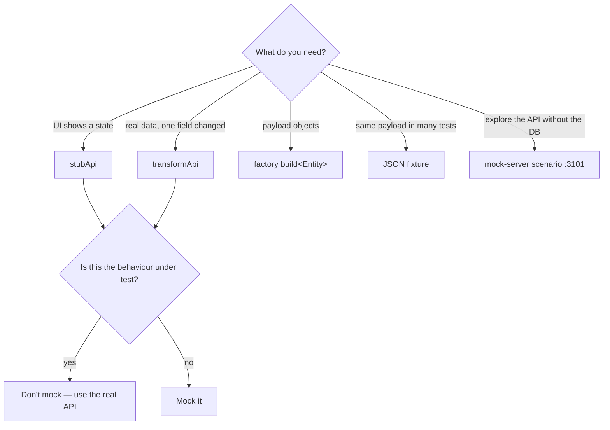

# 09 · Mocks and stubs

A **test double** replaces a real dependency so you can test something in isolation or reach a state
that is hard to produce for real (an empty list, a 500 error, 100+ items, a slow response). TAP26 has
three kinds, all built by the `mock-smith` agent and all following the OpenAPI contract.

| Double | Where | Runs in | Best for |
|---|---|---|---|
| **Route stub** — `stubApi` / `transformApi` | `playwright/src/ui/network.ts`, named stubs in `playwright/src/mocks/stubs.ts` | a Playwright test's browser | UI states: empty, error, edge data |
| **Factory** — `build<Entity>(overrides)` | `playwright/src/mocks/factories.ts` | test code | realistic payloads for stubs and API calls |
| **JSON fixture** | `playwright/test-data/*.json`, `tap26/mocks/fixtures/` | test code | fixed, reviewed payloads (e.g. `public-transactions.json`) |
| **Mock server scenario** | `tap26/mocks/scenarios/*.json` served by `mock-server.mjs` on **:3101** | a separate Node process | exploring/demoing API states without touching the DB |

## When to mock — and when not

Ask one question: **"What am I testing, and what am I just standing on?"**

| Situation | Mock? | Why |
|---|---|---|
| "The feed shows an empty-state message when there are no transactions" | ✅ stub `GET /transactions` → `{ results: [] }` | seeding an empty feed is slow and fragile |
| "An error banner appears when the API returns 500" | ✅ stub with status 500 | you cannot make the real API fail on demand |
| "Creating a bank account saves it" | ❌ | that *is* the behaviour under test — hit the real API |
| End-to-end journeys | ❌ | the point is that all layers work together |
| A long list (pagination UI) | ✅ factory + stub | the seed may not have enough items |
| Third-party login (Auth0, Okta…) | ✅ or skip | needs external credentials |

A stub that hides the behaviour under test makes the test lie. `mock-smith` refuses that kind of request.

## Route stubs in Playwright

```ts
import { test, expect } from "@fixtures/ui";
import { loginByXstate, stubApi, transformApi, bySel } from "@ui";

test("shows the empty state when there are no notifications", async ({ page, users }) => {
  // register the stub BEFORE the navigation that triggers the request
  await stubApi(page, { method: "GET", path: "/notifications" }, { results: [] });
  await loginByXstate(page, users[0].username);
  await page.goto("/notifications");
  await expect(bySel(page, "empty-list-header")).toBeVisible();
});

test("caps a long transaction description", async ({ page, users }) => {
  await transformApi(page, { method: "GET", path: "/transactions/public" }, (body: any) => ({
    ...body,
    results: body.results.map((t: any, i: number) => (i === 0 ? { ...t, description: "x".repeat(300) } : t)),
  }));
  await loginByXstate(page, users[0].username);
  // …assert the first item is truncated
});
```

- `stubApi(page, matcher, body, status = 200)` — answers with your JSON; never reaches the server.
- `transformApi(page, matcher, fn)` — lets the real request through, then edits the JSON.
- Both already send the CORS headers the app needs. Don't hand-roll `page.route` without them.
- GraphQL: match by operation, e.g. `{ method: "POST", path: "/graphql", graphqlOperation: "ListBankAccount" }`.

## Factories

Pure functions that return frozen, contract-shaped objects. Override anything you assert on.

```ts
import { buildTransaction, buildTransactionList } from "@mocks";   // playwright/src/mocks

const big = buildTransaction({ amount: 1_000_000, description: "rent" });   // cents!
const many = buildTransactionList(25, { status: "complete" });
await stubApi(page, { method: "GET", path: "/transactions/public" }, { pageData: { page: 1, limit: 10, hasNextPages: true, totalPages: 3 }, results: many });
```

Rules: amounts in **cents**, dates ISO in UTC, ids short strings; assert on your overrides, not on random
faker output.

## The mock server (:3101)

`tap26/scripts/mock-server.mjs` serves the API **from the OpenAPI spec**: every documented operation
returns its example (or seed-backed data). A **scenario** overrides selected operations.

```bash
node tap26/scripts/mock-server.mjs                      # or: /tap-run mock · npm --prefix tap26 run tap:mock
curl -s http://localhost:3101/notifications             # default example data
curl -s -H "x-mock-scenario: empty-notifications" http://localhost:3101/notifications
curl -s "http://localhost:3101/notifications?__scenario=empty-notifications"
```

> **PowerShell users:** use `curl.exe` instead of `curl` (in PowerShell `curl` is an alias for
> `Invoke-WebRequest` and rejects these flags), or run the commands in Git Bash.

Choose a scenario with the **`x-mock-scenario` header** or the **`__scenario` query parameter**.
Scenario files are named descriptive kebab-case `.json` (`empty-notifications`, `server-error-transactions`);
each maps operations to a status, a body and an optional delay. The exact format is documented in the
usage header at the top of `mock-server.mjs`.

Use the mock server to explore the API shape, demo error states, or prototype a client — **not** to
point the RWA UI at it. UI tests use route stubs instead (the app always calls the real API origin).

## Asking for doubles

```
/tap-mocks stub GET /notifications empty
/tap-mocks factory transaction
/tap-mocks server transactions-create-422
```

You can also just describe what you need: *"Use the mock-smith agent to make GET /notifications
return an empty list in a UI test."*

`mock-smith` checks the shape in `openapi.yaml` and `playwright/src/types/models.ts`, builds the
doubles, proves each with one passing usage test or `curl`, and hands back a "Use it" line per double.
If the spec and the types disagree, it stops and reports drift to `contract-guardian`.

## Choosing the layer



> **Try it** — Write a UI test that stubs `GET /bankAccounts` (hint: the UI uses GraphQL
> `ListBankAccount`!) to return no accounts, and check what the page shows. Which matcher worked, and why?

Related: [07 Testing framework](07-testing-framework.md) · [08 API contract](08-api-contract-and-swagger.md) ·
[Lab 11 — Mocks](../labs/lab-11-mocks.md).
