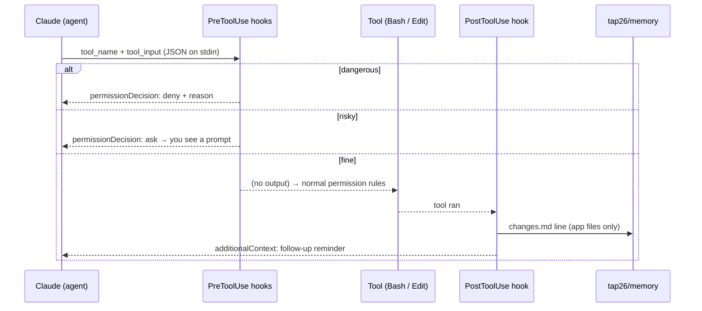

# 10 · Hooks and guardrails

A **hook** is a command Claude Code runs automatically when something happens: a session starts, you
submit a prompt, a tool is about to run, a tool just ran, a subagent stops. Hooks are **deterministic**
— they run every time, whatever the model "remembers" — which makes them the right place for safety
rules and logging.

TAP26's hooks are zero-dependency Node scripts in `.claude/hooks/`, wired up in `.claude/settings.json`
in **exec form**: Claude Code starts `node` directly with the script as an argument, with no shell in between:

```json
{ "type": "command", "command": "node", "args": ["${CLAUDE_PROJECT_DIR}/.claude/hooks/guard-bash.mjs"], "timeout": 10 }
```

So hooks behave the same in Git Bash, PowerShell, zsh or bash. They only need `node` on your `PATH`.

## What runs, and when

| Event | Matcher | Script | What it does |
|---|---|---|---|
| `SessionStart` | `startup\|resume\|clear\|compact\|fork` | `session-start.mjs` | injects a TAP26 banner, port health (3000/3001/3100/3101), today's change-ledger lines, a memory reminder; journals the session start |
| `UserPromptSubmit` | — | `journal.mjs` | appends your prompt (one line) to `tap26/memory/journal/<date>.md`; counts `/tap-*` skill usage |
| `PreToolUse` | `Bash` | `guard-bash.mjs` | **denies** destructive commands, **asks** before risky ones, explains why; keeps read-only agents read-only |
| `PreToolUse` | `Edit\|Write\|MultiEdit\|NotebookEdit` | `guard-edit.mjs` | **asks** before editing protected files; denies edits by read-only agents |
| `PostToolUse` | `Edit\|Write\|MultiEdit` | `change-ledger.mjs` | appends app edits to `tap26/memory/changes.md`; reminds Claude of follow-ups (OpenAPI, tests, docs) |
| `SubagentStop` | — | `journal.mjs` | journals which agent finished; counts agent usage |

Shared helpers are in `.claude/hooks/lib.mjs`. Every hook catches its own errors and exits 0, so a
broken hook never breaks your session — it just stops guarding.



## The Bash guard (`guard-bash.mjs`)

| Decision | Examples | Reason given |
|---|---|---|
| deny | `sudo …`, `rm -rf /`, `rm -rf ~`, `rm -rf .` | no elevated privileges; no recursive deletes of root/home/project |
| deny | `git push --force`, `git push -f` | rewrites shared history |
| deny | `curl … \| sh` | runs unreviewed code |
| deny | `> .env`, `> data/database-seed.json` | protects configuration and the shared seed |
| deny | `chmod -R 777`, `npm publish` | never needed here |
| ask | `git reset --hard`, `git clean -f`, `git checkout .` | discards work |
| ask | `git branch -D …`, `git branch --delete --force …` | force-deleting a branch loses commits that were not merged (e.g. a lab branch) |
| ask | `git stash drop`, `git stash clear` | permanently loses stashed work |
| ask | `git switch --force` / `-f` / `--discard-changes`, `git checkout --force` / `-f` | switches branch by discarding local changes |
| ask | `git push` | sharing work — was it reviewed? |
| ask | `yarn db:seed` | **regenerates** random seed data; use `yarn db:seed:dev` to reset |
| ask | `rm` inside `playwright/tests`, `cypress/tests`, `tap26/memory` | deleting tests or memory |

## The edit guard (`guard-edit.mjs`)

Asks before any agent edits: `data/database-seed.json`, `data/empty-seed.json`, `.env*` files,
lockfiles, `.claude/settings*.json`, anything in `.claude/hooks/`, the agent, skill and rule definitions
(`.claude/agents/**`, `.claude/skills/**`, `.claude/rules/**`, `.claude/output-styles/**`) and `CLAUDE.md`.
So **an agent can never silently change the rules it runs under.** Framework changes go through
`/tap-evolve`, where you approve them.

## Read-only agents

`tutor` and `code-reviewer` must never change your work, and hooks enforce this, not just their
instructions. The hooks read the `agent_type` field Claude Code sends:

- `guard-edit.mjs` **denies** any edit by these agents outside `.claude/agent-memory/` (their private notes);
- `guard-bash.mjs` **denies** write-type shell commands (`git add/commit/switch/reset…`, `rm`, `mv`,
  redirection `>`, installs, `playwright test`, `memory.mjs add-…`, reseeding). Inspection commands
  such as `git diff`, `git log`, `cat`, `grep`, the doctor and the typecheck stay allowed.

They return their review or explanation to the caller, who saves it.

## Permissions in `.claude/settings.json`

Hooks work together with permission rules:

| List | Examples | Effect |
|---|---|---|
| `allow` | `Bash(node tap26/scripts/*)`, `Bash(npx playwright test *)`, `Bash(git diff *)`, `Bash(yarn types)` | runs without a prompt |
| `ask` | `Bash(git push *)`, `Bash(yarn add *)`, `Bash(npm install *)`, `Bash(rm *)` | always prompts |
| `deny` | `Read(./.env.local)`, `Bash(sudo *)` | never allowed |

The file also sets `env` (`TAP26=1`, `TAP26_VERSION=1.0.0`). Your personal overrides go in
`.claude/settings.local.json` (not committed).

> Prefix rules are not a security boundary — a command can be wrapped in `sh -c`. That is why the
> Bash guard inspects the **whole** command string. Neither is a sandbox: always read the prompt.

## Inspecting and disabling hooks

| Where | How |
|---|---|
| VS Code panel | type `/` → **Customize** section → **Hooks**: see hooks loaded in the session grouped by event; add/edit/remove user, project or local hooks |
| VS Code panel | **Customize → Permissions**: see allow/ask/deny rules |
| CLI | `/hooks` opens a read-only browser of configured hooks and their source |
| Files | `.claude/settings.json` (the wiring), `.claude/hooks/*.mjs` (the logic) |
| Journal | `tap26/memory/journal/<date>.md` lines starting `[guard]` show every deny/ask |

To switch hooks off temporarily (e.g. to see the difference), add to `.claude/settings.local.json`:

```json
{ "disableAllHooks": true }
```

Start a new session afterwards, and **remove it when you are done** — with hooks off, nothing guards
Bash, edits are not ledgered and `/tap-sync-tests` loses the ledger. To silence only the journal, set
the environment variable `TAP26_JOURNAL=0`.

> **Privacy:** the journal (`tap26/memory/journal/`) records your prompts and `tap26/memory/.state/`
> holds hook state such as usage counters. Both are **gitignored** and stay on your machine.
> `/tap-retro` summarises them into tracked files (`learnings.md`, `tap26/reports/retros/`,
> `tap26/reports/bugs/`, which are committed).

> The memory digest still loads with hooks disabled, because `CLAUDE.md` imports
> `@tap26/memory/MEMORY.md` directly.

## Test a hook by hand

Hooks read JSON on stdin, so you can run them like any script:

```bash
echo '{"tool_name":"Bash","tool_input":{"command":"git push --force"}}' | node .claude/hooks/guard-bash.mjs
echo '{"tool_name":"Bash","tool_input":{"command":"ls"}}' | node .claude/hooks/guard-bash.mjs   # prints nothing = allowed
```

The first command prints a `permissionDecision: "deny"` JSON and exits 0. It also writes a `[guard]`
line to today's journal, so expect that side effect.

## Exercise — write your own hook

Goal: **block `waitForTimeout` in Playwright tests**. Hard waits make tests slow and flaky, and the
framework's convention is to wait for a response or use a web-first assertion instead.

1. Create `.claude/hooks/no-hard-waits.mjs`:
   ```js
   #!/usr/bin/env node
   import { readInput, respond, safely } from "./lib.mjs";

   await safely(async () => {
     const input = await readInput();
     const path = String(input?.tool_input?.file_path ?? "");
     const text = String(input?.tool_input?.new_string ?? input?.tool_input?.content ?? "");
     if (!/playwright\/tests\//.test(path) || !/waitForTimeout\(/.test(text)) return;
     respond({
       hookSpecificOutput: {
         hookEventName: "PreToolUse",
         permissionDecision: "deny",
         permissionDecisionReason: "TAP26: no hard waits — use waitForApi or a web-first assertion (expect(...).toBeVisible()).",
       },
     });
   });
   ```
2. Register it in `.claude/settings.json` under `PreToolUse`, matcher `Edit|Write|MultiEdit`, in exec form:
   `{ "type": "command", "command": "node", "args": ["${CLAUDE_PROJECT_DIR}/.claude/hooks/no-hard-waits.mjs"] }`.
   The edit guard will ask you to approve this change. That is the guard working.
   Then run `node tap26/scripts/check-framework.mjs --strict` (task **TAP: Framework check**). It
   verifies that every hook in `settings.json` points to an existing script.
3. Test by hand with `echo '{…}' | node .claude/hooks/no-hard-waits.mjs`.
4. In a new session ask: *"Add `await page.waitForTimeout(1000)` to auth.spec.ts."* It should be refused.
5. Propose it for everyone with `/tap-evolve propose block hard waits in tests` (see [11 Evolving TAP26](11-evolving-tap26.md)).

Windows: hooks use exec form, so they do not depend on a shell. They only need `node` on the `PATH`
that VS Code / Claude Code sees. Still install **Git for Windows**: Claude Code's Bash tool uses Git Bash,
and `node tap26/scripts/doctor.mjs` warns on Windows when Git Bash is missing. See
[13 Troubleshooting](13-troubleshooting.md#hooks-do-not-fire-windows).

Related: [05 Memory](05-memory-and-self-learning.md) · [Lab 15 — Evolve](../labs/lab-15-evolve.md).
