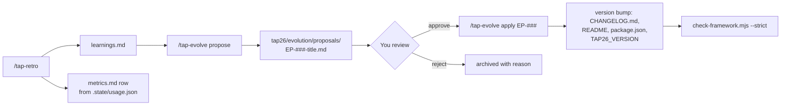

# 11 · Evolving TAP26

TAP26 is meant to be changed — by you, by your instructor and (with approval) by its own
`knowledge-curator`. This page shows how to change each building block safely, how changes are
proposed and versioned, and how to test a change to the framework itself.

## What you can change

| Building block | File(s) | Typical change |
|---|---|---|
| Agent | `.claude/agents/<name>.md` | sharpen a procedure, add a standard, new specialist |
| Skill | `.claude/skills/tap-<name>/SKILL.md` (+ sibling files) | new pipeline, better gates, new arguments |
| Rule | `.claude/rules/<area>.md` with `paths:` frontmatter | conventions that apply only to some files |
| Hook | `.claude/hooks/<name>.mjs` + `.claude/settings.json` | new guardrail or automatic log |
| Script | `tap26/scripts/<name>.mjs` | new deterministic tool |
| Template | `tap26/templates/*.md` | better bug report / test plan format |
| Knowledge | `tap26/knowledge/*.md` | curated facts about the app |

The names of all existing agents, skills and scripts are the contract in [BLUEPRINT](../BLUEPRINT.md) — read
it before renaming anything.

## Add or modify an agent

1. Copy a similar agent, e.g. `.claude/agents/data-tester.md` → `.claude/agents/i18n-tester.md`.
2. Edit the frontmatter:
   ```yaml
   ---
   name: i18n-tester
   description: Internationalisation tester for the RWA. Use when … Examples: "check all
     amounts are formatted for en-GB", "find hard-coded strings in the sign-up form".
   tools: Read, Grep, Glob, Edit, Write, Bash     # least privilege! omit Agent
   model: inherit
   color: green
   memory: project
   ---
   ```
   The **description** decides when Claude picks the agent: say *what* and *when*, with two example
   requests.
3. Keep the nine body sections in order: mission · *You are consulted for* · *Before you start* · *How
   you work* · *Standards* · *Outputs* (with the hand-off format) · *Memory duties* · *Boundaries* ·
   *Teaching mode*.
4. Add a row to the orchestrator's routing table in `.claude/agents/tap-orchestrator.md`.
5. Start a new session (agents are loaded at session start) and test it (see below).

## Add or modify a skill

1. Create `.claude/skills/tap-i18n/SKILL.md`:
   ```yaml
   ---
   name: tap-i18n
   description: Check a screen for internationalisation issues. Use when …
   argument-hint: "<screen or flow>"
   ---
   ```
2. Body sections: `## Goal`, `## Inputs` (use `$ARGUMENTS`), `## Steps` (numbered, each naming the
   agent), `## Quality gates`, `## Output`, `## Memory`, `## Learn more`.
3. Inline shell (`` !`git status --short` ``) runs when the skill is invoked — use only safe, read-only
   commands; a failing command aborts the skill.
4. Keep `SKILL.md` under 500 lines; put long checklists in sibling files and link them.
5. Type `/tap-` — your skill should appear. If not, see [13 Troubleshooting](13-troubleshooting.md).

## Write a rule

Rules load only when Claude reads or edits matching files, so they cost no context otherwise.

```markdown
---
paths: ["playwright/tests/**"]
---
# Playwright test rules
- Import test/expect from @fixtures/api or @fixtures/ui.
- No waitForTimeout; start waitForApi before the action.
```

## Add a hook

Write a Node script that reads JSON from stdin and prints a decision or context (see the exercise in
[10 Hooks & guardrails](10-hooks-and-guardrails.md)), then register it in `.claude/settings.json` in exec
form (`"command": "node"`, `"args": ["${CLAUDE_PROJECT_DIR}/.claude/hooks/<file>.mjs"]`). The edit guard
asks you to approve changes to hooks, settings, agents, skills, rules and `CLAUDE.md`. That is on purpose.

## Propose evolutions with `/tap-evolve`

The framework improves itself through a **human-approved** loop:



A proposal contains: the problem (with learning ids and journal evidence), the exact diff to an agent,
skill, rule or hook, the expected effect, how to test it, and the version impact. Nothing is applied
without your explicit approval.

The evidence comes from the loop's measurements:

- `/tap-retro` appends a row to `tap26/evolution/metrics.md` using the skill/agent usage counters that
  the journal hook keeps in `tap26/memory/.state/usage.json` (local, gitignored), plus the session's
  learnings and gate failures.
- `/tap-evolve apply EP-###` applies the approved diff and bumps the version in **four places**:
  `tap26/evolution/CHANGELOG.md`, `tap26/README.md`, `tap26/package.json` and `TAP26_VERSION` in
  `.claude/settings.json`. That last file is protected, so expect an approval prompt.
- After **any** framework change, by the curator or by hand, run
  `node tap26/scripts/check-framework.mjs --strict` (VS Code task **TAP: Framework check**). It must
  report no errors or warnings before you commit.

## Versioning

TAP26 uses semantic versioning, starting at **1.0.0** (`TAP26_VERSION` in `.claude/settings.json`).

| Bump | When | Example |
|---|---|---|
| patch `1.0.x` | wording, clearer steps, bug fix in a script | tighten `ui-automation` selector rules |
| minor `1.x.0` | new agent, skill, hook, script or argument — backwards compatible | add `tap-i18n` |
| major `x.0.0` | change a contract others depend on | new hand-off format, memory file format, renamed skill |

Record each release in `tap26/evolution/CHANGELOG.md` (`## 1.1.0 — 2026-11-02` + Added/Changed/Fixed)
and update the version in `tap26/README.md`, `tap26/package.json` and `TAP26_VERSION` in
`.claude/settings.json`. `/tap-evolve apply` does all four for you.

## Testing a change to the framework

Changes to prompts are code changes — test them.

| Check | How |
|---|---|
| It is consistent | `node tap26/scripts/check-framework.mjs --strict` (task **TAP: Framework check**): frontmatter, references, paths, links, JSON, hook wiring |
| It loads | new session → `/agents` (CLI) or type `/tap-` → the agent/skill is listed |
| It triggers | ask a request matching the description *without* naming it; was it chosen? |
| It doesn't over-trigger | ask an unrelated request; it should *not* be chosen |
| It follows the format | the hand-off report has all six fields |
| Scripts | run them by hand: `node tap26/scripts/<name>.mjs --help`, on Windows too if you can |
| Hooks | pipe sample JSON into them (see doc 10) |
| No regressions | run `/tap-doctor` and one existing workflow (e.g. `/tap-new-test api "…"`) |

Write down 2–3 test prompts with the expected behaviour in the proposal so the next person can re-run them.

## Contribution checklist

- [ ] Names follow the BLUEPRINT (kebab-case agents, `tap-` skills); no renamed contracts without a major bump
- [ ] Least privilege: only the tools the job needs; `Agent` only if delegation is required
- [ ] Description says *what* + *when* + two examples
- [ ] Memory duties use `node tap26/scripts/memory.mjs`
- [ ] Scripts are zero-dependency Node `.mjs` and work on Windows; hooks are registered in exec form
- [ ] Docs updated: [03 Agents](03-agents.md) or [04 Skills](04-skills.md), plus this page if the process changed
- [ ] Tested with the table above; test prompts written down
- [ ] `node tap26/scripts/check-framework.mjs --strict` passes
- [ ] `CHANGELOG.md` entry + version bump (CHANGELOG, `tap26/README.md`, `tap26/package.json`, `TAP26_VERSION`); decision recorded with `memory.mjs add-decision` if it changes how agents work
- [ ] `/tap-review` on the diff before committing

> **Try it** — Run `/tap-evolve review` after a few sessions (or `/tap-evolve propose <idea>`). Read one proposal critically: is the
> evidence real? Would the change help? Approve or reject it with a reason.

Hands-on: [Lab 15 — Evolve the framework](../labs/lab-15-evolve.md).
