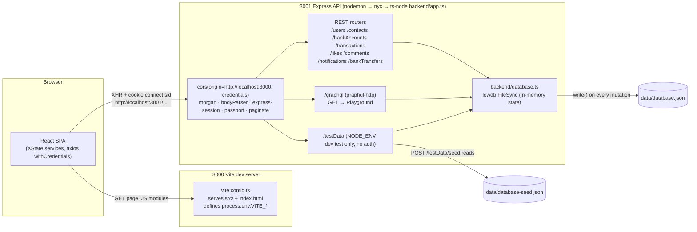
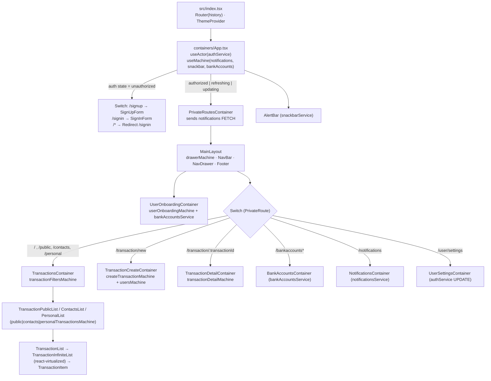
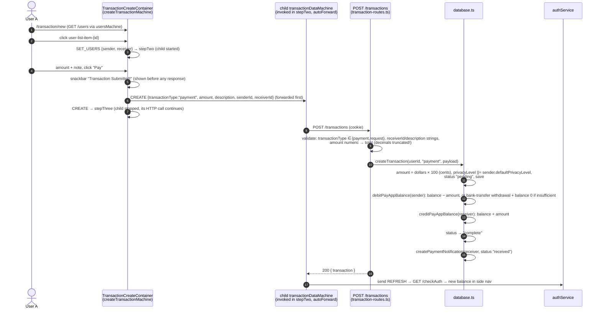

> **Purpose:** System overview of the Real World App: stack, runtime topology, backend pipeline, frontend composition, payment lifecycle, auth variants, coverage and test hooks.
> **Last verified:** 2026-10-16 (against commit `c5f5d9f`, app running on :3000/:3001)

# App architecture

The Cypress Real World App (RWA) is a Venmo-style payments demo. A **React 18 single-page app**
served by **Vite on :3000** talks directly, cross-origin, to an **Express API on :3001**. The API keeps all
data in **one JSON file through lowdb** and authenticates with a **session cookie**. Bank accounts are
also exposed through a small **GraphQL** endpoint, and that is what the UI uses for them.

## 1. Tech stack

Versions are as declared in `package.json`. Where `node_modules` resolves to a different version, the installed one is shown.

| Layer | Library | Version | Where used |
|---|---|---|---|
| Runtime | Node | `.nvmrc` **22.20.0**, `engines: ^22 \|\| ^24` | everything |
| Package manager | Yarn classic | 1.22.22 (`packageManager`) | root. `playwright/` uses **npm** |
| UI framework | React / React DOM | 18.2.0 | `src/` |
| Bundler / dev server | Vite | ^8.2.2 (installed 8.2.2) + `@vitejs/plugin-react` ^6.1.0 | `vite.config.ts` |
| Components | MUI `@mui/material` | ^5.15.12 (installed **5.16.12**), `@mui/icons-material`, `@mui/lab` | `src/components` |
| Styling | Emotion | ^11 | MUI `styled()` |
| State | XState | **4.38.3** + `@xstate/react` 3.2.2 | `src/machines` |
| Routing | react-router-dom | **5.3.4** (v5 API: `Switch`, `useHistory`) + `history` 4.10.1 | `src/containers` |
| Forms | Formik 2.4.6 + Yup 0.32.11 | | sign-in/up, bank account, transaction, settings |
| HTTP client | axios 0.28.1 (`withCredentials: true`) | | `src/utils/asyncUtils.ts` |
| Money | dinero.js ^2.0.0 | | `src/utils/transactionUtils.ts` |
| Dates | date-fns 4.1.0, date-fns-tz ^3.2.0, react-calendar ^6 | | filters, UTC helpers |
| Lists | react-virtualized 9.22.5 (`InfiniteLoader` + `List`) | | `TransactionInfiniteList.tsx` |
| Number input | react-number-format 4.9.4 | | amount field |
| API server | Express | 4.20.0 | `backend/app.ts` |
| Auth | passport 0.5.0 + passport-local 1.0.0, express-session 1.18.0, bcryptjs 2.4.3 | | `backend/auth.ts` |
| Validation | express-validator | **6.15.0** | `backend/validators.ts` |
| Pagination | express-paginate | 1.0.2 (default limit from `PAGINATION_PAGE_SIZE`=10, **max 50**) | `backend/app.ts` |
| Database | lowdb (FileSync) | **1.0.0** | `backend/database.ts` |
| Search | fuse.js | 6.5.3 | `searchUsers()` |
| IDs | shortid 2.2.16, uuid 8.3.2 | | every entity has `id` (shortid) + `uuid` |
| GraphQL | graphql 16.8.1, graphql-http ^1.22, @graphql-tools/*, graphql-playground-middleware-express | | `backend/graphql/` |
| TS execution | ts-node 10.9.2 under `nyc` 15.1.0, nodemon 2.0.22 | | `start:api:watch` |
| Language | TypeScript | 5.8.3 (`strict: true`) | everywhere |
| Unit tests | Vitest ^3.2.4 + jsdom + Testing Library | | `src/__tests__`, `src/utils/__tests__` |
| E2E / CT (original) | Cypress | ^16.1.1 (installed 16.1.1) + `@cypress/code-coverage`, Percy | `cypress/`, `src/**/*.cy.tsx` |
| E2E (TAP26) | Playwright | `@playwright/test` **1.56.0** | `playwright/` |
| Seed data | @faker-js/faker | 6.1.2 (root), ^9.9.0 (playwright) | `scripts/seedDataUtils.ts` |

## 2. Runtime topology

Key facts:

- **There is no proxy in dev.** The SPA calls `http://localhost:${process.env.VITE_BACKEND_PORT}`
  directly. Every machine builds that URL from `src/utils/portUtils.ts`. So every API call is **cross-origin** and
  depends on CORS with `credentials: true` (`backend/app.ts:31-34, 53`).
- **CORS has one hard-coded origin.** The API answers *every* request with
  `Access-Control-Allow-Origin: http://localhost:3000`, even when the request comes from another origin (verified with `curl -H "Origin: http://localhost:3100"`).
  Browser pages on any other origin therefore fail. This is why the Swagger UI uses a same-origin proxy (`tap26/scripts/swagger-server.mjs`, :3100).
- **Port fallback.** `getBackendPort()` (`src/utils/portUtils.ts`) uses `detect-port`. If 3001 is busy, the API starts on
  another port and prints a red warning. The UI keeps calling 3001.
- **Env exposure.** `vite.config.ts` loads only `VITE_*` variables and injects them as
  `process.env.*` into the browser bundle (`define: { "process.env": env }`).
- **lowdb is in memory.** `low(new FileSync("data/database.json"))` reads the file **once at start-up**. Every
  mutation calls `.write()`, which rewrites the whole file. Editing the JSON file by hand while the API runs has no effect,
  and the API's next write overwrites your edit. Use `POST /testData/seed`.
- **Production-like mode.** `yarn start:ci` runs `scripts/testServer.ts`, which serves the `build/` folder on :3000 with
  `connect-history-api-fallback` and `src/setupProxy.js`. That proxy targets `process.env.BACKEND_PORT`, which is not defined in `.env` *(unverified whether it is set in CI)*.

## 3. Repository layout (app parts)

| Path | What lives there |
|---|---|
| `backend/app.ts` | Express app, middleware order, router mounting, GraphQL wiring, listen |
| `backend/auth.ts` | passport local strategy, `POST /login`, `POST /logout`, `GET /checkAuth` |
| `backend/*-routes.ts` | one router per resource (users, contact, bankaccount, banktransfer, transaction, like, comment, notification, testdata, gql-playground) |
| `backend/validators.ts` | express-validator chains (`isTransactionPayloadValidator`, `isUserValidator`, …) |
| `backend/helpers.ts` | `ensureAuthenticated`, `validateMiddleware` (→ 422), JWT middlewares for Auth0/Okta/Cognito/Google |
| `backend/database.ts` | **all business logic**: queries, feeds, balances, notifications, seeding |
| `backend/graphql/schema.graphql`, `resolvers/` | `listBankAccount`, `createBankAccount`, `deleteBankAccount` |
| `src/index.tsx` | React root: `Router(history)` → MUI theme → `<App/>` |
| `src/index.{auth0,okta,cognito,google}.tsx` | alternative roots for third-party auth (swap manually, see §6) |
| `src/containers/` | route-level containers (`App`, `PrivateRoutesContainer`, `Transactions*`, `BankAccounts`, `Notifications`, `UserSettings`, `UserOnboarding`) |
| `src/components/` | presentational MUI components (forms, lists, nav, filters) + `*.cy.tsx` component tests |
| `src/machines/` | XState machines (see [state-machines.md](state-machines.md)) |
| `src/models/` | TypeScript domain types and enums, **shared by backend and frontend** |
| `src/utils/` | `transactionUtils.ts` (money, filters, pagination, UTC dates, shared with the backend), `asyncUtils.ts` (axios), `portUtils.ts`, `historyUtils.ts` |
| `data/` | `database.json` (live, **git-tracked**), `database-seed.json`, `empty-seed.json` |
| `scripts/` | `generateSeedData.ts` + `seedDataUtils.ts` (seed generator), `testServer.ts`, mock aws-exports |

## 4. Backend request pipeline (order matters)

The order below is from `backend/app.ts`:

| # | Middleware / mount | Effect |
|---|---|---|
| 1 | `@cypress/code-coverage/middleware/express` (only if `global.__coverage__`) | adds `GET /__coverage__`. Always present in dev, because ts-node runs under `nyc` |
| 2 | `cors({ origin: "http://localhost:3000", credentials: true })` | see §2 |
| 3 | `morgan("dev")` | request log in the API terminal |
| 4 | `bodyParser.urlencoded`, `bodyParser.json` | |
| 5 | `express-session({ secret: "session secret", resave:false, saveUninitialized:false })` | cookie `connect.sid`, HttpOnly. Default **MemoryStore**, so sessions are lost on restart |
| 6 | `passport.initialize()`, `passport.session()` | `req.user` = full user record (deserialised by id) |
| 7 | `paginate.middleware(PAGINATION_PAGE_SIZE)` | sets `req.query.page` (default 1) and `req.query.limit` (default 10, capped at 50) |
| 8 | `/testData` router, **only if `NODE_ENV` is `test` or `development`** | mounted *before* auth, so it needs **no login** |
| 9 | `auth` router at `/` | `/login`, `/logout`, `/checkAuth` |
| 10 | JWT middleware if `VITE_AUTH0` / `VITE_OKTA` / `VITE_AWS_COGNITO` / `VITE_GOOGLE` | validates `Authorization: Bearer …` (skips `/testData/*`) |
| 11 | `GET /` | text `Cypress Realworld App - backend` |
| 12 | `/graphql`: playground router (GET) then `graphql-http` handler | context `{ user: req.user }`. **No auth check**, see [api-overview.md](api-overview.md#graphql) |
| 13 | `/users`, `/contacts`, `/bankAccounts`, `/transactions`, `/likes`, `/comments`, `/notifications`, `/bankTransfers` | resource routers. Most handlers use `ensureAuthenticated` |
| 14 | `express.static(public/)` | |

There is **no error-handling middleware**. An exception in a handler, such as `GET /transactions/<unknown id>`, returns
Express's default **500 HTML page with a stack trace** (verified).

## 5. Frontend composition

- `authService` is a **module-level singleton** (`src/machines/authMachine.ts`). It is persisted to
  `localStorage["authState"]` on every transition and **rehydrated on page load**. This is how a reload keeps you "logged
  in" in the UI. The server session must still be valid.
- `notificationsService`, `snackbarService` and `bankAccountsService` are created once in `App.tsx` and passed down as props.
  The page-level machines are created by `useMachine` inside each container, so they reset whenever the route remounts.
- Every data machine is built from the generic `dataMachine` factory
  (`idle → loading → success.{withData|withoutData} | failure`). See [state-machines.md](state-machines.md).

## 6. Request lifecycle: creating a payment

For a **request** (`transactionType: "request"`), the same route stores `requestStatus: "pending"`, moves **no money** and
creates a `"requested"` notification for the receiver. Accepting or rejecting it is
`PATCH /transactions/:id { requestStatus }`. `updateTransactionById` then **always** debits the receiver, credits the requester,
sets `status: "complete"` and notifies the requester with "received", **even when the request is rejected**. This was verified
in an isolated copy of `database.ts`. It is a real app bug, listed in [gotchas.md](gotchas.md) and [test-map.md](test-map.md).

## 7. Authentication

### Local (default)

| Step | Where | Details |
|---|---|---|
| Login | `POST /login` (`backend/auth.ts`) | passport-local looks the user up by `username` (first match) and compares with `bcrypt.compareSync`. Wrong credentials → 401 text `Unauthorized`. Missing fields → 400 `Bad Request` |
| Remember me | body `remember: true` | cookie `maxAge` = 30 days. Otherwise a browser-session cookie |
| Session | `connect.sid` | `serializeUser` stores `user.id`, `deserializeUser` loads the full user on each request |
| Who am I | `GET /checkAuth` | `{ user }` or 401 `{ error: "User is unauthorized" }` |
| Logout | `POST /logout` | clears the cookie, destroys the session, **302 → `/`** |
| UI | `authMachine` | `LOGIN` → `loading` → `authorized` (redirects `/signin` → `/`). `LOGOUT` → `logout` → `unauthorized` (removes `localStorage.authState`) |

The `user` object returned by `/login` and `/checkAuth` **includes the bcrypt password hash** (verified).

### Third-party providers (opt-in)

Each provider needs **three changes**: the yarn script that sets a `VITE_*` flag, real credentials in `.env`, *and*
manually replacing `src/index.tsx` with the provider's entry file (README "3rd Party Authentication Providers").
Setting the env flag alone does not switch the frontend.

| Provider | Script (sets flag) | Frontend entry → container | Backend middleware (`helpers.ts`) | UI → authMachine event | Cypress spec |
|---|---|---|---|---|---|
| Auth0 | `yarn dev:auth0` (`VITE_AUTH0`) | `src/index.auth0.tsx` → `AppAuth0.tsx` | `checkAuth0Jwt` (RS256 via JWKS) | `AUTH0 {user, token}` | `cypress/tests/ui-auth-providers/auth0.spec.ts` |
| Okta | `yarn dev:okta` (`VITE_OKTA`) | `src/index.okta.tsx` → `AppOkta.tsx` | `verifyOktaToken` | `OKTA` | `…/okta.spec.ts` |
| AWS Cognito | `yarn dev:cognito` (`VITE_AWS_COGNITO`, runs `build:aws-exports-es5` first) | `src/index.cognito.tsx` → `AppCognito.tsx` | `checkCognitoJwt` | `COGNITO` | `…/cognito.spec.ts` |
| Google | `yarn dev:google` (`VITE_GOOGLE`) | `src/index.google.tsx` → `AppGoogle.tsx` | `checkGoogleJwt` | `GOOGLE` | `…/google.spec.ts` |

With a provider active, `httpClient` (`src/utils/asyncUtils.ts`) adds `Authorization: Bearer <localStorage[VITE_AUTH_TOKEN_NAME]>`,
and `ensureAuthenticated` maps the JWT `sub` to `req.user.id`. The TAP26 Playwright suite does **not** port these specs.

## 8. Coverage instrumentation

| Side | Mechanism | When active |
|---|---|---|
| Backend | `yarn tsnode` = `nyc --silent ts-node …`. When `global.__coverage__` exists, `app.ts` mounts `@cypress/code-coverage/middleware/express` → `GET /__coverage__` | **always** in `yarn dev`. `GET http://localhost:3001/__coverage__` returns 200 |
| Frontend | `vite-plugin-istanbul` with `cypress: true, requireEnv: true, forceBuildInstrument: true` | only when `CYPRESS_COVERAGE=true` (`yarn dev:coverage`, `yarn build:ci`). Plain `yarn dev` serves uninstrumented code (verified) |
| Collection | `@cypress/code-coverage` support + task (`cypress/support/e2e.ts`, `cypress.config.ts`) | Cypress runs with coverage enabled. `nyc.exclude: src/models/*.ts` |
| Hints | `/* istanbul ignore next */` comments throughout backend and machines | marks provider-only or defensive branches |

Playwright does not collect coverage.

## 9. Test hooks on `window`

When `window.Cypress` is truthy at module evaluation or render time, the app attaches XState services to `window`:

| Global | Set in | Condition | Used for |
|---|---|---|---|
| `window.authService` | `src/containers/App.tsx` (and each `App<Provider>.tsx`) | `window.Cypress` | programmatic `LOGIN`/`LOGOUT` (`cy.loginByXstate`, Playwright `loginByXstate`) |
| `window.createTransactionService` | `src/containers/TransactionCreateContainer.tsx:41` | **always** (no guard) | `SET_USERS` + `CREATE` (`cy.createTransaction`, `createTransactionViaApp`) |
| `window.publicTransactionService` | `src/components/TransactionPublicList.tsx` | `window.Cypress` | `FETCH {page}` (`cy.nextTransactionFeedPage`, `fetchFeedPage`) |
| `window.contactTransactionService` | `src/components/TransactionContactsList.tsx` | `window.Cypress` | same |
| `window.personalTransactionService` | `src/components/TransactionPersonalList.tsx` | `window.Cypress` | same |

Playwright sets the flag before any app script runs: `exposeAppServices(page)` →
`page.addInitScript(() => window.Cypress = true)` (`playwright/src/ui/app.ts`). The `page` fixture in
`playwright/src/fixtures/index.ts` applies it to every UI test.

## 10. Configuration reference (`.env`)

| Variable | Value | Used by |
|---|---|---|
| `PORT` | 3000 | `frontendPort` (CORS origin, testServer) |
| `VITE_BACKEND_PORT` | 3001 | API listen port and every UI request URL |
| `PAGINATION_PAGE_SIZE` | 10 | express-paginate default limit |
| `SEED_*` | users 5, contacts 3, payments 15, requests 10, bank accounts 1, likes 2, comments 2, notifications 5, bank transfers 5 per user | `scripts/seedDataUtils.ts` (only when regenerating the seed) |
| `SEED_DEFAULT_USER_PASSWORD` | `s3cret` | seed password hash, Cypress `env.defaultPassword` |
| `VITE_AUTH0*`, `VITE_OKTA*`, `AWS_COGNITO_*`, `VITE_GOOGLE_*`, `VITE_AUTH_TOKEN_NAME` | commented out | third-party auth |
