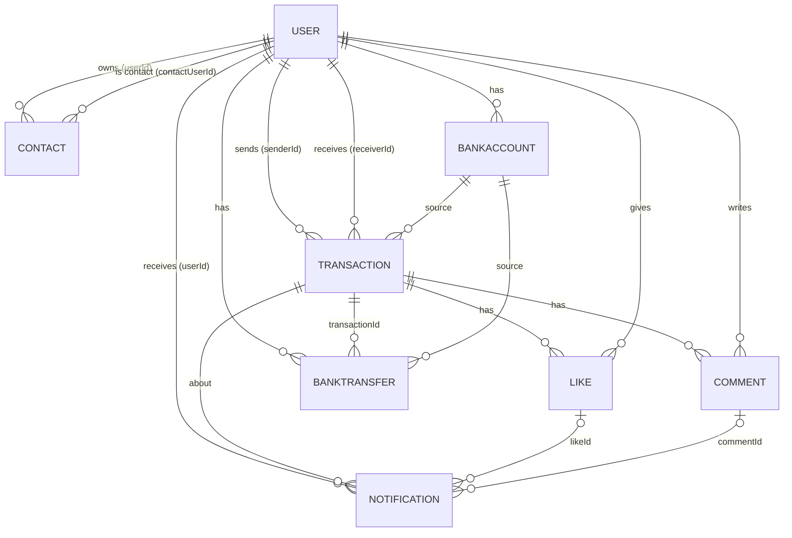
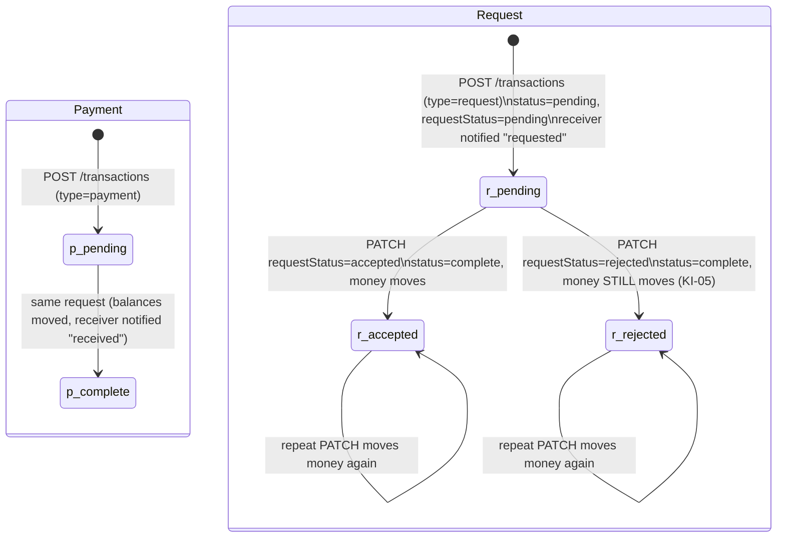

> **Purpose:** Entities and fields, relationships, money and balances, transaction lifecycle, privacy levels and feeds, notification types, seed characteristics, and how to reset or regenerate data.
> **Last verified:** 2026-10-16 (types in `src/models/*.ts`, logic in `backend/database.ts`, counts computed from `data/database-seed.json`. At verification time `data/database.json` was byte-identical to the seed)

# Data model

All data lives in **one lowdb JSON document**, `data/database.json`, with eight top-level arrays (`DbSchema` in
`src/models/db-schema.ts`). The types in `src/models/` are shared by backend, frontend, seed scripts and Vitest.
There are no foreign-key constraints: relations are plain id strings.

Every record has `id` (**shortid**, e.g. `uBmeaz5pX`), `uuid` (v4), `createdAt` and `modifiedAt`. These are ISO strings in JSON. The TS type is `Date`.

## Entities

| Entity (table) | Fields (besides id/uuid/createdAt/modifiedAt) | Source |
|---|---|---|
| **User** (`users`) | `firstName`, `lastName`, `username`, `password` (bcrypt hash; plain text if set through `PATCH`, KI-04), `email`, `phoneNumber`, `avatar` (URL), `balance` (**cents**), `defaultPrivacyLevel` (`public`\|`private`\|`contacts`) | `src/models/user.ts` |
| **Contact** (`contacts`) | `userId` (owner), `contactUserId` (the friend). **One-directional**: A→B does not imply B→A | `contact.ts` |
| **BankAccount** (`bankaccounts`) | `userId`, `bankName`, `accountNumber`, `routingNumber`, `isDeleted` (soft delete) | `bankaccount.ts` |
| **Transaction** (`transactions`) | `source` (bank account id), `amount` (cents), `description`, `privacyLevel`, `senderId`, `receiverId`, `balanceAtCompletion?`, `status` (`pending`\|`incomplete`\|`complete`), `requestStatus?` (`pending`\|`accepted`\|`rejected`, or `""`/absent for payments), `requestResolvedAt?` | `transaction.ts` |
| **Like** (`likes`) | `userId` (liker), `transactionId` | `like.ts` |
| **Comment** (`comments`) | `userId` (author), `transactionId`, `content` | `comment.ts` |
| **Notification** (`notifications`) | `userId` (recipient), `transactionId`, `isRead`, plus **one of** `status` (payment: `requested`\|`received`\|`incomplete`), `likeId`, `commentId` | `notification.ts` |
| **BankTransfer** (`banktransfers`) | `userId`, `source` (bank account id), `amount` (cents), `type` (`withdrawal`\|`deposit`), `transactionId` | `banktransfer.ts` |

API-only enriched shapes: `TransactionResponseItem` (+ `senderName`, `receiverName`, `senderAvatar`, `receiverAvatar`,
`likes[]`, `comments[]`) and `NotificationResponseItem` (+ `userFullName`).

### Sender and receiver: the naming trap

| Type | `senderId` | `receiverId` | Money moves |
|---|---|---|---|
| Payment | the payer (creator) | the payee | sender → receiver, immediately on creation |
| Request | the **requester** (creator, who gets paid) | the person **asked to pay** | receiver → sender, when the request is updated via PATCH |

So for a request, the "sender" receives money. `TransactionAmount` shows **"+"** for every request and **"−"** for every
payment, whoever is viewing.

## Relationships

## Money and balances

- **Cents everywhere in storage and responses.** `formatAmount(cents)` (dinero.js, USD) renders `$1,509.53`.
- **`POST /transactions` takes dollars**: `amount` → `toInt()` (truncates decimals) → `× 100` (`database.ts:535`). The UI
  sends dollars from the amount field. `POST /users` `balance` is taken **as cents**.
- **Payment** (`createTransaction`): sender `balance -= amount`. If the result would be ≤ 0 (dinero `isPositive` is strict),
  a `withdrawal` BankTransfer of `|balance − amount|` is created and the balance becomes **0**. Receiver `balance += amount`.
- **Request accepted *or rejected*** (`updateTransactionById`): the receiver is debited the same way and the sender credited. The
  money moves on rejection too (KI-05).
- `balanceAtCompletion` exists only in seed data. The API never writes it.
- Seed balances range from $494.74 (`Judah_Dietrich50`) to $1,588.80 (`Dina20`).

## Transaction lifecycle

| Combination (`status` / `requestStatus`) | Created by the API? | In the seed |
|---|---|---|
| `complete` / `""` (completed payment) | yes | 165 |
| `pending` / `""` (pending payment) | no (the API completes payments instantly) | 135 |
| `pending` / `pending` (open request) | yes | 153 |
| `complete` / `accepted` | yes (PATCH) | 63 |
| `complete` / `rejected` | yes (PATCH) | 84 |
| `incomplete` / any | no (enum value only) | 0 |

UI labels (`TransactionTitle`): payment → "paid", request → "requested", accepted request → "charged".
Accept/Reject buttons appear only for `requestStatus === "pending"` when the viewer is the receiver.

## Privacy levels and feeds

`privacyLevel` is set per transaction: from the body, or else the sender's `defaultPrivacyLevel`. The UI never sends it,
so new transactions always use the sender's default. The UI has no control to change that default.

| Feed / endpoint | Which transactions | Is `privacyLevel` respected? |
|---|---|---|
| Mine: `GET /transactions` | mine (sender or receiver) | n/a (all mine) |
| Friends: `GET /transactions/contacts` | all transactions of my contacts (`contactUserId`s of my contact rows) | **no**: `private` and `contacts` items of contacts are included |
| Everyone: `GET /transactions/public` | page 1: first 5 contacts' transactions + `public` transactions not involving my contacts; later pages: only the latter | **partly**: the non-contact part is `public` only, but the 5 contact items can be `private` (verified: item 3 of Heath93's page 1 is `private`) |
| Detail: `GET /transactions/:id` | any id | **no** check (KI-06) |

The `contacts` level is not enforced anywhere. It only matters because it is not `public`.

## Notifications

| Type | Created when | Recipient(s) | UI text (`NotificationListItem`) |
|---|---|---|---|
| payment `requested` | request created | receiver (the one asked to pay) | "<requester> requested payment." |
| payment `received` | payment created | receiver | "<recipient's own name> received payment." |
| payment `received` | request accepted/rejected (PATCH) | sender (requester) | "<requester's own name> received payment." |
| like | `POST /likes/:id` | **both** sender and receiver (even the liker themselves) | "<liker> liked a transaction." |
| comment | `POST /comments/:id` | **both** sender and receiver | "<commenter> commented on a transaction." |

`GET /notifications` returns only unread notifications. "Dismiss" sets `isRead: true`, which removes the item from the list. There is
no "read" view.

## Seed data (`data/database-seed.json`)

| Table | Count | Notes |
|---|---|---|
| users | **5** | all with password **`s3cret`** (one shared bcrypt hash) |
| contacts | **15** | 3 per user, one-directional |
| bankaccounts | **5** | 1 per user, none deleted |
| transactions | **600** | 120 generated per user (15 payments × 2 scenarios × 2 directions + 10 requests × 3 scenarios × 2 directions) with one random counterpart. Per-user totals vary (120–360) because they are also counterparts of others |
| likes | 10 | 2 per user, on others' public transactions |
| comments | 10 | 2 per user |
| notifications | **40** | 8 per user (1 like, 1 comment, 3 requested, 3 received), **all unread** |
| banktransfers | 50 | 5 deposit + 5 withdrawal per user |

| Characteristic | Value |
|---|---|
| Privacy split | public 195 · private 189 · contacts 216 |
| Amounts | 1,053 – 49,941 cents ($10.53 – $499.41) |
| `createdAt` range | 2023-03-09 → 2024-03-07 (UTC) |
| `description` | generated text like `Payment: <senderId> to <receiverId>` / `Request: <receiverId> to <senderId>` |
| `source` | always a bank account id (the generating user's, even for inverse transactions) |

### Seeded users (in seed order; Playwright `users[0]` = `Heath93`)

| # | username | name | id | default privacy | balance | contacts → | transactions |
|---|---|---|---|---|---|---|---|
| 0 | `Heath93` | Ted Parisian | `uBmeaz5pX` | public | $1,509.53 | Dina20, Reyes.Osinski, Arvilla_Hegmann | 360 |
| 1 | `Arvilla_Hegmann` | Kristian Bradtke | `GjWovtg2hr` | private | $930.26 | Dina20, Heath93, Reyes.Osinski | 120 |
| 2 | `Dina20` | Darrel Ortiz | `_XblMqbuoP` | contacts | $1,588.80 | Heath93, Arvilla_Hegmann, Judah_Dietrich50 | 120 |
| 3 | `Reyes.Osinski` | Ruthie Prosacco | `M1ty1gR8B3` | private | $1,176.83 | Arvilla_Hegmann, Heath93, Judah_Dietrich50 | 240 |
| 4 | `Judah_Dietrich50` | Lia Rosenbaum | `WHjJ4qR2R2` | public | $494.74 | Arvilla_Hegmann, Reyes.Osinski, Heath93 | 360 |

List them yourself with `yarn list:dev:users` or `GET /testData/users`. These values change if the seed is regenerated.

## Reset and regenerate

| Goal | Command | Effect / caveats |
|---|---|---|
| Reset while the API runs (**preferred**) | `curl -X POST http://localhost:3001/testData/seed` | replaces the API's in-memory state with the seed and writes `database.json`. Every Playwright/Cypress test does this |
| Copy the seed file | `yarn db:seed:dev` (`ncp data/database-seed.json data/database.json`) | file only. A **running API keeps its in-memory data** and overwrites the file on its next write. `yarn dev` runs it automatically (`predev`) |
| Empty DB | `yarn start:empty` (or `yarn db:seed:empty` + restart) | no users. Sign up to see onboarding |
| Regenerate the seed | `yarn db:seed` (runs `scripts/generateSeedData.ts`, then `postdb:seed` copies it) | ⚠ **new random users, ids, usernames and amounts.** Breaks docs, memory facts and any hard-coded data. Ask first (CLAUDE.md non-negotiable). The current committed seed also differs from the generator: its avatars use `seed=<firstName>`, the generator uses the id |
| Inspect | `GET /testData/<entity>`, Playwright `db.filter/find`, Cypress `cy.database("filter"\|"find", …)` | raw rows, no auth |

`data/database.json` is **tracked by git**. Running the app or tests shows it as modified (`git status`). Restore it with
`git checkout data/database.json`, or reseed, before committing.
