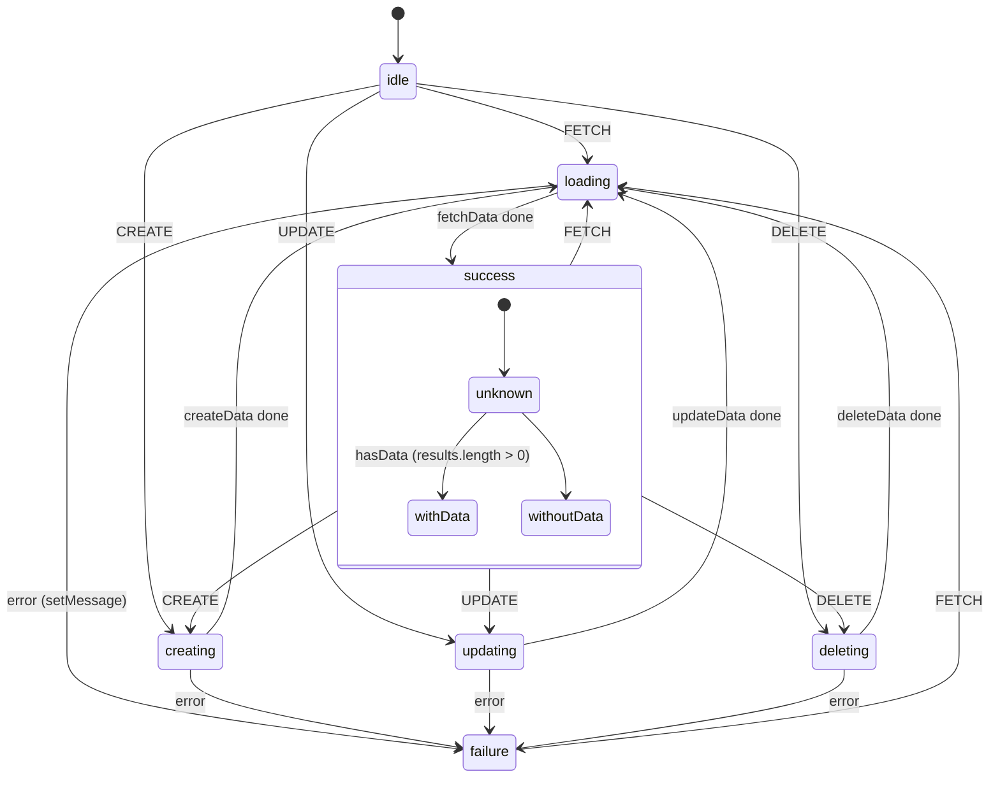
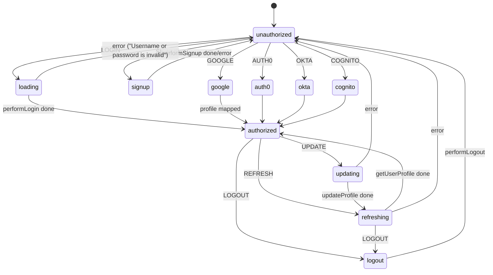

> **Purpose:** Reference for every XState machine in `src/machines/`: purpose, states, events, services/actions, who uses it, and which ones tests can reach on `window`.
> **Last verified:** 2026-10-16 (code in `src/machines/*.ts` and `src/containers|components`, XState 4.38.3 behaviour checked in `node_modules/xstate/lib/interpreter.js`)

# State machines (XState 4)

All machines use the **XState v4 API** (`Machine(...)`, `interpret`, `withConfig`, `assign`) with `@xstate/react` 3
hooks (`useMachine`, `useActor`). The generated inventory is in `generated/state-machines.md`.

## Overview

| Machine (file) | id | Kind | Instantiated in | Lifetime | On `window` |
|---|---|---|---|---|---|
| `authMachine` (`authMachine.ts`) | `authentication` | custom | **module singleton** `authService = interpret(authMachine).start(rehydrated)` | whole app; persisted to `localStorage.authState` | `authService` (if `window.Cypress`) |
| `dataMachine(id)` (`dataMachine.ts`) | param | **factory** for all data machines | – | – | – |
| `notificationsMachine` | `notifications` | dataMachine | `App.tsx` `useMachine` → passed down | app | – |
| `bankAccountsMachine` | `bankAccounts` | dataMachine (GraphQL) | `App.tsx` `useMachine` → passed down | app | – |
| `snackbarMachine` | `snackbar` | custom | `App.tsx` `useMachine` | app | – |
| `drawerMachine` | `drawer` | custom, parallel | `MainLayout.tsx` | private layout | – |
| `userOnboardingMachine` | `userOnboarding` | custom | `UserOnboardingContainer.tsx` | private layout (resets on reload) | – |
| `transactionFiltersMachine` | `filters` | custom, parallel | `TransactionsContainer.tsx` | feed pages | – |
| `publicTransactionsMachine` | `publicTransactions` | dataMachine | `TransactionPublicList.tsx` | Everyone tab | `publicTransactionService` (if `window.Cypress`) |
| `contactsTransactionsMachine` | `contactsTransactions` | dataMachine | `TransactionContactsList.tsx` | Friends tab | `contactTransactionService` (if `window.Cypress`, note the singular "contact") |
| `personalTransactionsMachine` | `personalTransactions` | dataMachine | `TransactionPersonalList.tsx` | Mine tab | `personalTransactionService` (if `window.Cypress`) |
| `createTransactionMachine` (+ inner `transactionDataMachine`) | `createTransaction` | custom + invoked dataMachine | `TransactionCreateContainer.tsx` | `/transaction/new` | `createTransactionService` (**always**, no guard) |
| `usersMachine` | `users` | dataMachine | `TransactionCreateContainer.tsx` | `/transaction/new` | – |
| `transactionDetailMachine` | `transactionData` | dataMachine | `TransactionDetailContainer.tsx` | `/transaction/:id` | – |

## `dataMachine` factory (`dataMachine.ts`)

The generic CRUD machine behind 8 machines. Each concrete machine supplies `services` via `.withConfig()`.



| Piece | Behaviour |
|---|---|
| Context | `{ pageData: {}, results: [], message }` |
| `setResults` (entry of `success`) | if the response has `pageData.page > 1`, it **appends** to `results` (infinite scroll). Otherwise it **replaces** them |
| `setPageData` | stores `{ page, limit, hasNextPages, totalPages }` |
| Event payloads | the event object minus `type` becomes the request params/body (`omit("type", event)`) |
| Failure | the only way out of `failure` is `FETCH`. A `CREATE`/`UPDATE` sent in `failure` is ignored |

### Concrete data machines

| Machine | `fetchData` | `createData` | `updateData` | `deleteData` |
|---|---|---|---|---|
| `publicTransactionsMachine` | `GET /transactions/public` (params = event payload: `page`, date/amount filters) | – | – | – |
| `contactsTransactionsMachine` | `GET /transactions/contacts` | – | – | – |
| `personalTransactionsMachine` | `GET /transactions` | – | – | – |
| `notificationsMachine` | `GET /notifications` | – | `PATCH /notifications/{id}` | – |
| `usersMachine` | `GET /users`, or `GET /users/search?q=` when the payload is not empty | – | – | – |
| `bankAccountsMachine` | GraphQL `ListBankAccount` → `{ results, pageData: {} }` | GraphQL `CreateBankAccount` | – | GraphQL `DeleteBankAccount` |
| `transactionDetailMachine` | `GET /transactions/{id}` (id from context or payload) → `{ results: [transaction] }` | `POST /likes/{id}` if `entity === "LIKE"`, else `POST /comments/{id}` | `PATCH /transactions/{id}` | – |
| `transactionDataMachine` (inner) | – | `POST /transactions`, then `authService.send("REFRESH")` | – | – |

## `authMachine` (`authMachine.ts`)



| Service | Call | Notes |
|---|---|---|
| `performSignup` | `POST /users` | then `history.push("/signin")`. The machine returns to `unauthorized` (no auto-login) |
| `performLogin` | `POST /login` (event = `{username, password, remember}`) | then `history.push("/")`. Any error → "Username or password is invalid" |
| `getUserProfile` | `GET /checkAuth` | used by `REFRESH` and after `UPDATE` |
| `updateProfile` | `PATCH /users/{id}` | payload from `UserSettingsForm` |
| `performLogout` | `POST /logout` | also removes `localStorage.authState` |
| `get{Google,Auth0,Okta,Cognito}UserProfile` | none | map provider claims to a `User`, store the token in `localStorage[VITE_AUTH_TOKEN_NAME]` |

| Action | Effect |
|---|---|
| `resetUser` (entry of `unauthorized`) | `user = undefined` |
| `onSuccess` / `setUserProfile` | `user = event.data.user` |
| `onError` | `message = event.data.message` (shown as `signin-error`) |
| `redirectHomeAfterLogin` (entry of `authorized`) | if the path is `/signin` → `window.location.pathname = "/"` (full reload). This also fires when an `authorized` state is rehydrated, verified by visiting `/signin` while logged in |

**Persistence:** `onTransition` writes the whole state to `localStorage.authState`. At module load it is restored with
`State.create` + `resolveState`. A stale `authorized` state with a dead server session gives a layout with empty lists:
every call returns 401 and no redirect happens (verified by clearing cookies). See [gotchas.md](gotchas.md).

## `createTransactionMachine` (`createTransactionMachine.ts`)

```mermaid
stateDiagram-v2
  [*] --> stepOne
  stepOne --> stepTwo: SET_USERS {sender, receiver}
  stepTwo --> stepThree: CREATE {transactionType, amount, description, senderId, receiverId}
  stepThree --> stepOne: RESET
  note right of stepTwo: invokes transactionDataMachine (autoForward: true)
```

- Entry actions: `clearContext` (stepOne), `setSenderAndReceiver` (stepTwo), `setTransactionDetails` (stepThree, stores the
  CREATE event, which step 3 renders).
- **How the POST happens:** XState 4 forwards an event to auto-forwarded children *before* computing the parent's
  transition (`interpreter.js`: `forward(_event)` then `_nextState`). The child receives `CREATE` → `creating` →
  `POST /transactions`. Then the parent leaves `stepTwo`, which stops the child. The HTTP call still completes, but its result
  and errors are never seen by the UI.
- Tests drive it directly: `window.createTransactionService.send("SET_USERS", {sender, receiver})` then
  `.send("CREATE", {...})`. See `cy.createTransaction` and Playwright `createTransactionViaApp`
  (`playwright/src/ui/transactions.ts`). You must be on `/transaction/new` so the service exists.

## `transactionFiltersMachine` (parallel)

| Region | States | Events | Context |
|---|---|---|---|
| `dateRange` | `none` → `filter` | `DATE_FILTER {dateRangeStart, dateRangeEnd}`, `DATE_RESET` | `dateRangeStart`, `dateRangeEnd` (UTC ISO) |
| `amountRange` | `none` ⇄ `filter` (self-transition on new `AMOUNT_FILTER`) | `AMOUNT_FILTER {amountMin, amountMax}`, `AMOUNT_RESET` | `amountMin`, `amountMax` (cents) |

`TransactionsContainer` derives the query objects from the context and passes them to the active list. A change
triggers `FETCH` with page 1.

## `drawerMachine` (parallel)

| Region | Initial | Events | Notes |
|---|---|---|---|
| `desktop` | `open` | `TOGGLE_DESKTOP`, `CLOSE_DESKTOP`, `OPEN_DESKTOP` (guard `shouldOpenDesktop`) | `MainLayout` sends `OPEN_DESKTOP` when the viewport grows to ≥ 600 px while closed |
| `mobile` | `closed` | `TOGGLE_MOBILE`, `OPEN_MOBILE`, `CLOSE_MOBILE` | used when `breakpoints.only("xs")` (< 600 px). Backdrop click → `CLOSE_MOBILE` |

## `userOnboardingMachine`

`stepOne` →NEXT→ `stepTwo` →NEXT→ `stepThree` →NEXT→ `done` (final). `PREV` goes back from stepTwo and stepThree.
An `idle` state exists but is never the initial state. The dialog visibility rules are in [ui-map.md](ui-map.md), section "First login: onboarding dialog".

## `snackbarMachine`

`invisible` →SHOW {severity, message}→ `visible` →(`HIDE` or **after 3000 ms**)→ `invisible`. Rendered by `AlertBar` as
`alert-bar-{severity}`.

## Driving machines from tests

| Goal | Cypress | Playwright |
|---|---|---|
| Fast login | `cy.loginByXstate(username)` → `win.authService.send("LOGIN", …)` | `loginByXstate(page, username)` (`playwright/src/ui/auth.ts`) |
| Logout / switch user | `cy.logoutByXstate()`, `cy.switchUserByXstate(u)` | `logoutByXstate(page)`, `switchUser(page, u)` |
| Create transaction | `cy.createTransaction(payload)` | `createTransactionViaApp(page, draft)` |
| Load feed page N | `cy.nextTransactionFeedPage(service, n)` | `fetchFeedPage(page, feed, n)` |
| Generic | `cy.window().then(w => w.<svc>.send(...))` | `sendToService(page, svc, event, payload)`, `waitForService(page, svc)` (`playwright/src/ui/app.ts`) |

Prerequisite: `window.Cypress` must be truthy before the app bundle runs. Playwright's `page` fixture calls
`exposeAppServices(page)` for you.
