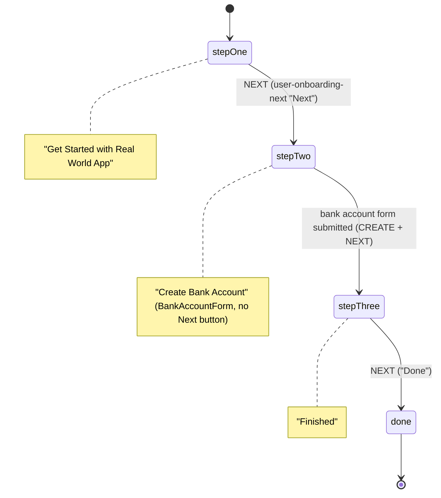

> **Purpose:** Map of every UI route and screen: path → container/components, what the user can do, key `data-test` selectors, driving XState machines, empty/error states, mobile vs desktop, onboarding.
> **Last verified:** 2026-10-16 (code in `src/` and a read-only Playwright probe against :3000 at 1280, 600, 599, 414, 413 and 375 px)

# UI map

The full selector inventory is generated in `generated/ui-selectors.md`. This file explains the
**important** selectors in context. Selector helpers: Playwright `bySel`/`bySelLike`/`textbox`
(`playwright/src/ui/selectors.ts`), Cypress `cy.getBySel`/`cy.getBySelLike` (`cypress/support/commands.ts`).

## Route table

Routing uses react-router **v5** (`Switch`/`Route`) with a shared `history` object (`src/utils/historyUtils.ts`).

| Path | Auth | Container → main components | Machines | Tests (Playwright / Cypress) |
|---|---|---|---|---|
| `/signin` | public | `App` → `SignInForm` | `authService` | `ui/auth.spec.ts` / `ui/auth.spec.ts` |
| `/signup` | public | `App` → `SignUpForm` | `authService` | same |
| any other path while logged out | public | `Redirect` → `/signin` | – | auth spec "should redirect unauthenticated user…" |
| `/`, `/public` | private | `PrivateRoutesContainer` → `TransactionsContainer` → `TransactionPublicList` | `transactionFiltersMachine`, `publicTransactionsMachine` | `ui/transaction-feeds.spec.ts` |
| `/contacts` | private | … → `TransactionContactsList` | `contactsTransactionsMachine` | same |
| `/personal` | private | … → `TransactionPersonalList` | `personalTransactionsMachine` | same |
| `/transaction/new` | private | `TransactionCreateContainer` → `TransactionCreateStepOne/Two/Three` | `createTransactionMachine`, `usersMachine`, `snackbarService` | `ui/new-transaction.spec.ts` |
| `/transaction/:transactionId` | private | `TransactionDetailContainer` → `TransactionDetail`, `CommentForm`, `CommentList` | `transactionDetailMachine` | `ui/transaction-view.spec.ts` |
| `/bankaccounts` (matches `/bankaccounts*`) | private | `BankAccountsContainer` → `BankAccountList` | `bankAccountsService` (GraphQL) | `ui/bankaccounts.spec.ts` |
| `/bankaccounts/new` | private | `BankAccountsContainer` → `BankAccountForm` | `bankAccountsService` | same |
| `/notifications` | private | `NotificationsContainer` → `NotificationList` | `notificationsService` | `ui/notifications.spec.ts` |
| `/user/settings` | private | `UserSettingsContainer` → `UserSettingsForm` | `authService` (`UPDATE`) | `ui/user-settings.spec.ts` |
| unknown path while logged in | private | layout only, **empty content** (no 404 page). Verified with `/nope` | – | not tested |
| `/signin` while logged in | – | `authorized` entry action redirects to `/` (verified) | `authService` | – |

"Private" routes are rendered only when `authService` is in `authorized`, `refreshing` or `updating`
(`src/containers/App.tsx`). Otherwise `App` renders the public `Switch`.

## Persistent layout (all private routes)

`MainLayout` (`src/components/MainLayout.tsx`) = `NavBar` + `NavDrawer` + `<main data-test="main">` + `Footer`.
The `UserOnboardingContainer` dialog is mounted on every private page.

| Area | Selectors | Behaviour |
|---|---|---|
| Top bar | `sidenav-toggle` (hamburger), `drawer-icon`, `app-name-logo`, `nav-top-new-transaction` ("$ New"), `nav-top-notifications-link`, `nav-top-notifications-count` (badge = number of **unread** notifications) | badge comes from `notificationsService`, fetched once by `PrivateRoutesContainer` and again whenever `/notifications` mounts |
| Feed tabs | `nav-transaction-tabs`, `nav-public-tab` ("Everyone"), `nav-contacts-tab` ("Friends"), `nav-personal-tab` ("Mine") | shown **only** on `/`, `/public`, `/contacts`, `/personal`. Hidden on transaction detail (tested). The selected tab has class `Mui-selected`. Re-clicking the selected tab does **not** refetch (memory L-003) |
| Side nav | `sidenav`, `sidenav-user-full-name` ("First L"), `sidenav-username` ("@username"), `sidenav-user-balance` (USD from cents), `sidenav-home`, `sidenav-user-settings`, `sidenav-bankaccounts`, `sidenav-notifications`, `sidenav-signout` | balance refreshes after a transaction (`authService` `REFRESH` → `GET /checkAuth`) |
| Snackbar | `alert-bar-success` / `alert-bar-error` / `alert-bar-info` / `alert-bar-warning` | `snackbarMachine`, auto-hides after **3 s**. Transaction success is shown after the API responds; failed payment submissions show a generic inline `role="alert"` message |

## Screens

### Sign in: `/signin` (`src/components/SignInForm.tsx`)

| Element | Selector | Notes |
|---|---|---|
| Username | `signin-username` (on the **MUI wrapper** → use `… input`) | Yup: required. Autofocused |
| Password | `signin-password` (wrapper) | Yup: required, min 4 |
| Remember me | `signin-remember-me` (checkbox wrapper → `… input`) | sends `remember: true` → 30-day cookie |
| Submit | `signin-submit` | disabled while the form is invalid or submitting |
| Sign-up link | `signup` | navigates to `/signup` |
| Error | `signin-error` | MUI `Alert` with "Username or password is invalid" from `authMachine.performLogin` |

Validation messages appear after **blur** or a value change. Helper text ids are `username-helper-text` and `password-helper-text`.

### Sign up: `/signup` (`src/components/SignUpForm.tsx`)

Fields (all wrappers): `signup-first-name`, `signup-last-name`, `signup-username`, `signup-password`,
`signup-confirmPassword`. Also `signup-submit` and `signup-title`. Yup: all required, password min 4,
confirm must match ("Password does not match"). Submit → `authService` `SIGNUP` → `POST /users`
(it also sends `confirmPassword`, which the API ignores) → navigates to **`/signin`**. There is **no
auto-login**, and a duplicate username is not rejected (KI-15).

### First login: onboarding dialog (`src/containers/UserOnboardingContainer.tsx`)

- **Opens when** `bankAccountsService` reaches `success.withoutData` with an empty list and the onboarding machine
  is not `done`. It also stays open in `stepTwo`/`stepThree` after an account exists. Seeded users each have a bank account, so
  they never see it. Only newly signed-up users (or a `yarn start:empty` DB) do.
- Soft-deleted accounts still count as accounts, so deleting your only account does **not** reopen onboarding.
- `userOnboardingMachine` is local to the component, so a page reload restarts it at `stepOne`.
- Selectors: `user-onboarding-dialog`, `user-onboarding-dialog-title`, `user-onboarding-dialog-content`,
  `user-onboarding-next`, `user-onboarding-logout` (available on every step). The bank-account form inside uses the
  `bankaccount-*` selectors below.
- The dialog is **full-screen below the `md` breakpoint (< 900 px)**.

### Transaction feeds: `/`, `/public`, `/contacts`, `/personal`

Components: `TransactionsContainer` → `TransactionListFilters` + `Transaction{Public|Contacts|Personal}List`
→ `TransactionList` → `TransactionInfiniteList` (react-virtualized) → `TransactionItem`.

| Feed (tab) | API | List header | What's in it |
|---|---|---|---|
| Everyone (`/`, `/public`) | `GET /transactions/public` | "Public" | page 1: up to 5 contacts' transactions (any privacy), then public transactions not involving contacts |
| Friends (`/contacts`) | `GET /transactions/contacts` | "Contacts" | every transaction of each contact, any privacy |
| Mine (`/personal`) | `GET /transactions` | "Personal" | every transaction I sent or received |

| Element | Selector | Notes |
|---|---|---|
| List container | `transaction-list` | virtualised: only visible rows exist in the DOM. Scroll it to load the next page (`InfiniteLoader`, threshold 2 rows) |
| Row | `transaction-item-{id}` | click → `/transaction/{id}` |
| Row parts | `transaction-sender-{id}`, `transaction-action-{id}` (" paid " / " requested " / " charged " for accepted requests; rejected requests also read " requested "), `transaction-receiver-{id}`, `transaction-amount-{id}` (**"+" for requests, "−" for payments, regardless of who is viewing**), `transaction-like-count`, `transaction-comment-count` | |
| Loading | `list-skeleton` | only while loading **and** no page data yet (first load) |
| Empty | `empty-list-header` ("No Transactions"), `empty-list-children`, `transaction-list-empty-create-transaction-button` | the create button is shown for Public and Personal |
| Date filter chip | `transaction-list-filter-date-range-button` ("Date: ALL" or "Date: MMM, d yyyy - …"), `transaction-list-filter-date-clear-button` (cancel icon on the chip when active) | opens a **Popover** (≥ 600 px) or a bottom **Drawer** `date-range-filter-drawer` with `date-range-filter-drawer-close` (< 600 px). The calendar wrapper is `transaction-list-filter-date-range` (react-calendar, `selectRange`). Picking two days applies the filter and closes the picker |
| Amount filter chip | `transaction-list-filter-amount-range-button` ("Amount: $0 - $1,000") | opens a Popover / Drawer `amount-range-filter-drawer` (+ `amount-range-filter-drawer-close`). Inside: `transaction-list-filter-amount-range`, `-range-text`, `-range-slider` (MUI Slider, two `input[type=range]` thumbs), `transaction-list-filter-amount-clear-button` |

Filter maths and behaviour:

- **Date:** the picked local calendar days are converted to UTC ISO strings, with the local components reused as UTC
  (`localDateToUTCISOString`). The API compares them with `createdAt` (inclusive). Query: `dateRangeStart`, `dateRangeEnd`.
- **Amount:** the slider runs **0–100**. Each step = **$10** (`padAmountWithZeros(v) = ceil(v × 1000)` cents), so the range is
  $0–$1,000. Changes are debounced by 200 ms. Query: `amountMin`, `amountMax` in cents, **upper bound exclusive**.
- Filter state lives in `transactionFiltersMachine` inside `TransactionsContainer`. Switching tabs keeps the same
  container, so the filters persist across tabs *(by code reading)*. The chip label state lives in each filter component.

### New transaction: `/transaction/new` (3-step stepper)

| Step | Component | User action | Selectors | Machine events |
|---|---|---|---|---|
| 1 Select Contact | `TransactionCreateStepOne` → `UserListSearchForm` + `UsersList` | search (debounced 200 ms → `GET /users/search?q=`), or pick from all users (`GET /users`) | `user-list-search-input` (**on the `<input>`** via `inputProps`), `users-list`, `user-list-item-{userId}` (shows U:/E:/P: = username/email/phone) | `SET_USERS {sender, receiver}` |
| 2 Payment | `TransactionCreateStepTwo` | enter amount + note, click Request or Pay | `transaction-create-form`, `transaction-create-amount-input` (wrapper, NumberFormat with `$` and thousands separator, input id `amount`), `transaction-create-description-input` (wrapper), `transaction-create-submit-request`, `transaction-create-submit-payment` | `CREATE {transactionType, amount, description, senderId, receiverId}` |
| 3 Complete | `TransactionCreateStepThree` | read "Paid $X for …" / "Requested $X for …" | `new-transaction-return-to-transactions`, `new-transaction-create-another-transaction` | `RESET` |

Notes:
- Yup: amount required ("Please enter a valid amount"), note required ("Please enter a note"). `validateOnMount`, so both
  buttons start **disabled**.
- "Transaction Submitted!" (`alert-bar-success`) is shown **in `onSubmit`, before the API answers**, and step 3 is shown
  optimistically. A failing `POST /transactions` is not surfaced in the UI *(by code reading)*.
- Decimal amounts are accepted by the field but truncated by the API ($5.75 → $5.00, KI-18). Step 3 shows the same
  truncation (`parseInt(amount) * 100`).
- The receiver list is **all users**, not just contacts. Contacts only affect the feeds.

### Transaction detail: `/transaction/:transactionId` (`TransactionDetail.tsx`)

| Element | Selector | Behaviour |
|---|---|---|
| Header | `transaction-detail-header` ("Transaction Detail") | |
| Wrapper | `transaction-item-{id}` (same pattern as feed rows) | |
| Avatars | `transaction-sender-avatar`, `transaction-receiver-avatar` | |
| Title/amount | `transaction-sender-{id}`, `transaction-action-{id}`, `transaction-receiver-{id}`, `transaction-amount-{id}`, `transaction-description` | |
| Like | `transaction-like-count-{id}`, `transaction-like-button-{id}` | disabled once the current user has liked |
| Accept / reject | `transaction-accept-request-{id}`, `transaction-reject-request-{id}` | only if **I am the receiver** and `requestStatus === "pending"`. Sends `PATCH /transactions/{id}`. ⚠ reject still transfers money (KI-05) |
| Comment | `transaction-comment-input-{id}` (**on the `<input>`**) | no submit button: press **Enter**. Empty comments are allowed. The field is not cleared after submit *(by code reading)* |
| Comments | `comments-list`, `comment-list-item-{commentId}` | the list only renders when there is at least one comment |

States: the container shows "Loading..." only in `idle`. An **unknown id** → API 500 → machine `failure` → the content area
stays **empty** (verified). After like/comment/update, the machine re-fetches the transaction (`creating`/`updating` → `loading`).

### Bank accounts: `/bankaccounts`, `/bankaccounts/new`

| Element | Selector | Notes |
|---|---|---|
| Create button | `bankaccount-new` | → `/bankaccounts/new` |
| List | `bankaccount-list`, `bankaccount-list-item-{id}` | soft-deleted accounts stay listed as "Bank Name (Deleted)" with no delete button |
| Delete | `bankaccount-delete` | GraphQL `DeleteBankAccount` (soft delete) |
| Empty | `empty-list-header` ("No Bank Accounts") | |
| Form | `bankaccount-form`, `bankaccount-bankName-input`, `bankaccount-routingNumber-input`, `bankaccount-accountNumber-input` (all **wrappers**), `bankaccount-submit` | Yup: bank name ≥ 5 chars, routing number exactly 9, account number 9–12 (strings: digits are **not** enforced). Submit → GraphQL `CreateBankAccount` → navigates to `/bankaccounts` (not during onboarding) |

Any `/bankaccounts/<anything>` path other than `/new` shows the list (verified with `/bankaccounts/whatever`).

### Notifications: `/notifications`

| Element | Selector | Notes |
|---|---|---|
| List | `notifications-list`, `notification-list-item-{id}` | text by type: "X liked a transaction." · "X commented on a transaction." · "X requested payment." · "X received payment." |
| Dismiss | `notification-mark-read-{id}` | **desktop: "Dismiss" button; < 600 px: icon button with no text** (verified). Sends `PATCH /notifications/{id} {isRead:true}` → re-fetch, and the item disappears (the API returns unread only) |
| Empty | `empty-list-header` ("No Notifications") | |

### User settings: `/user/settings`

Form `user-settings-form` with `user-settings-firstName-input`, `user-settings-lastName-input`,
`user-settings-email-input`, `user-settings-phoneNumber-input` (all **on the `<input>`** via `inputProps`) and
`user-settings-submit`. Yup: all four required, email format, phone regex. Submit → `authService` `UPDATE` →
`PATCH /users/{id}` → `refreshing` → `GET /checkAuth`. `defaultPrivacyLevel` is in the Yup schema but has **no field**, so
users cannot change their default privacy from the UI. Newly signed-up users have no email or phone, so the form starts invalid.

## Mobile vs desktop

The app uses MUI default breakpoints (xs < 600 ≤ sm < 900 ≤ md < 1200). The test suites use their **own** threshold:
`isMobile()` = viewport width **< 414** (`cypress.config.ts` `mobileViewportWidthBreakpoint`, `playwright/src/config/env.ts`).
Widths from 414 to 599 px render the mobile layout, but the tests treat them as desktop.

| Behaviour | < 600 px (xs) | ≥ 600 px |
|---|---|---|
| Side nav | MUI **temporary** drawer, closed by default. Opened by `sidenav-toggle`. Nav items close it on click. Backdrop click closes it | **persistent** drawer, open by default (verified at 599 vs 600 px) |
| Logo | icon logo (`SvgRwaIconLogo`) | full logo |
| Date/amount filters | bottom **Drawer** with a "Close" button | **Popover** |
| Date picker size | `window.innerWidth × innerHeight` | 350 × 300 |
| Notification dismiss | check-icon button (no text) | "Dismiss" text button |
| Feed row height | 224 px (`spacing(28)`, `down("sm")`) | 128 px |

| Behaviour | < 900 px (below md) | ≥ 900 px |
|---|---|---|
| Onboarding dialog | full screen | modal |
| Row divider | full width | inset |

**Closing the mobile drawer in tests:** at 375 px the 240 px drawer covers the centre of the backdrop, so a
plain `backdrop.click()` lands on the drawer. Click the backdrop's right edge instead (`closeSideNavOnMobile` in
`playwright/src/ui/navigation.ts`, memory L-001).

## Selector placement cheat-sheet (MUI `TextField`)

| Pattern | Fields | How to reach the `<input>` |
|---|---|---|
| `data-test` on the **wrapper** (`<TextField data-test=…>`) | `signin-*`, `signup-*`, `bankaccount-*-input`, `transaction-create-*-input` | `[data-test="x"] input` (Playwright `textbox(page, "x")`) |
| `data-test` on the **input** (`inputProps={{"data-test": …}}`) | `user-settings-*-input`, `user-list-search-input`, `transaction-comment-input-{id}` | `input[data-test="x"]` |
| Checkbox wrapper | `signin-remember-me` | `[data-test="signin-remember-me"] input` |

`textbox()` in `playwright/src/ui/selectors.ts` resolves both cases.
